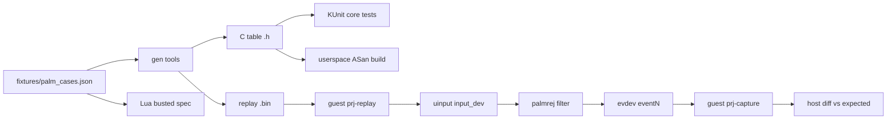

# Kernel palm rejection: senior-planner review (filter mode, QEMU, KUnit, gaps, roadmap)

**Date:** 2026-11-18 · **Inputs:** `01_plan_*`, `02_survey_*`, `03_findings_*`, the fork's `fastnote.koplugin`, KOReader `base/input/input.c`, `platform/kobo/*.sh`, `frontend/device/input.lua`, and kernel sources fetched at tags v4.9, v6.x and master.
**Tags:** **[V]** means I checked it this session against a source file, a fetched page, or `curl` of `raw.githubusercontent.com/torvalds/linux/<tag>/...`. **[U]** means I did not verify it.

## Verdict (5 lines)

1. **Filter mode works on 4.9, but a plain per-event `filter()` is not enough.** In 4.9, `filter()` is called once per value over a frame that has already been fully batched. It cannot look ahead, and `ABS_MT_TOOL_TYPE` / `ABS_MT_TOUCH_MAJOR` arrive *after* `ABS_MT_TRACKING_ID` [V]. The fix is a frame lookahead (read `dev->vals` under `event_lock`, check it, and pass everything through if the check fails). Drops must also follow a "mute" policy: never drop `ABS_MT_SLOT` or `ABS_MT_TOOL_TYPE`.
2. **Use QEMU, but as an x86_64 KVM guest running a 4.9 kernel, with in-guest `uinput` replay.** That is the main test rig. Run KUnit with mainline `kunit.py` on UML. An ARM `virt` 4.9 guest is only a secondary 32-bit sanity check. Emulating the MT8113 / Libra Colour is not realistic.
3. **KUnit cannot run on the device kernel.** KUnit arrived in 5.5 [V] and none of it backports to 4.9. Build a pure-C core with three consumers that share one JSON fixture file: KUnit on mainline, a userspace ASan/UBSan build, and the Lua busted spec. Phase 0.5 ("core, test-first") is the first real deliverable.
4. **I found three latent userland issues the Lua oracle would carry into the fixtures** (code-reading only; [U] until confirmed on the device). Fix them before the Lua code becomes the reference. (a) `pendev.lua` never clears `in_proximity`, so the state machine emits `hover` on every later SYN, finger frames included. (b) `palmreject.lua` defaults to `os.clock()`, which is CPU time, not wall time. (c) Tool value 2 is `MT_TOOL_PALM` in the Linux uapi but "eraser" in the fork and in upstream KOReader.
5. **KOReader's `EVIOCGRAB` bypasses every filter** (`input_pass_values` grab path [V]). `koreader.sh` sets `KO_DONT_GRAB_INPUT` except when MiniClock is present [V], so the module must detect a grab and report it.

## At a glance

| Question | Answer |
|---|---|
| Device / kernel | Libra Colour = `KoboMonza`, `isMTK`, `isSMP` [V device.lua]. Kobo publishes `hw/mt8113-libraC_vision7/` (`bootloader.tar.zst`, `kernel.tar.zst.part-aa/ab`) [V listing]. Kernel version inside is not yet read [U]. The only data point: a Clara Colour reports `4.9.77 #1 SMP PREEMPT` [V forum]. |
| Can KOReader insmod? | Yes. `platform/kobo/enable-wifi.sh` already runs `insmod` on MTK modules from `/drivers/${PLATFORM}/mt66xx` [V]. |
| 4.9 `filter()` semantics | Per value, over a complete batched frame, with `dev->event_lock` held (irqsave) and under `rcu_read_lock` [V]. Filters sit at the head of `h_list` [V]. A grab skips them [V]. |
| Mainline delta | Since 6.11, `events()` returns `unsigned int` [V header diff v6.10→v6.11]. Mainline also rejects handlers that define more than one of filter/events/event [V]. 4.9 allows `filter` plus `event` in one handler [V]. |
| QEMU injection | QMP `mtt` (8.1+) carries only x/y axes [V qapi/ui.json]: no tool, pressure, touch_major or stylus buttons. Primary path: in-guest `uinput`. `UI_DEV_SETUP` exists in 4.9 [V]. |
| Host today | `qemu-system-x86_64` 10.2.1 with `/dev/kvm`. No `qemu-system-arm`, no ARM cross gcc, no busybox. gcc is 15.2, too new for a 4.9 tree [V `which`; the gcc build failure is U]. |
| KUnit versions | KUnit 5.5. `KUNIT_ARRAY_PARAM`/`KUNIT_CASE_PARAM` 5.11. Static stubs 6.3. `kunit_add_action` 6.5. UML KASAN by 6.0. All [V by header/Kconfig at tags]. |

---

## 1. Libra Colour facts and what to confirm on the device

**Known:**
- [V] `frontend/device/kobo/device.lua`: `KoboMonza` has `isMTK`, `isSMP`, `pressure_event = ABS_MT_PRESSURE`, and `touch_mirrored_y = true`.
- [V] `github.com/kobolabs/Kobo-Reader/tree/master/hw/` contains `mt8113-libraC_vision7/` (Libra Colour) next to `mt8113-claraC_shine5C`, `mt8113-claraBW_shine5BW` and `mt8113-elipsa2e`. The kernel ships as a split zstd tarball.
- [V] MobileRead thread "A tool to flash eMMC and bypass secure boot on modern Kobos": recent Kobos use MT8113 and boot BROM → LK → U-Boot → Linux. LK source is not public. The thread says nothing specific about the Libra Colour.
- [V] KOReader `enable-wifi.sh` loads `wmt_drv`, `wmt_chrdev_wifi`, `wmt_cdev_bt` and `wlan_drv_gen4m` with plain `insmod` (the `insmod_asneeded` pattern checks `/proc/modules` first). KOReader therefore runs as root on MTK Kobos and module loading works there. Copy this pattern for the fastnote loader.
- [U] The Libra Colour kernel is probably 4.9.77 like the Clara Colour, with the same SoC family.

**Add these to `03_findings_device-recon-checklist.md` (all read-only):**

```bash
uname -r; cat /proc/version          # /proc/version names the GCC that built the kernel: match it
zcat /proc/config.gz | grep -E 'MODVERSIONS|MODULE_SIG|PREEMPT|SMP|HZ=|NO_HZ|DEBUG_ATOMIC|LOCKDEP|INPUT_UINPUT|INPUT_EVDEV'
cat /proc/bus/input/handlers          # any other filter handlers? (sysrq is one, keyboards only)
cat /sys/class/input/event1/device/capabilities/{ev,key,abs}
cat /sys/class/input/event1/device/properties
evtest --query /dev/input/event1 EV_ABS ABS_MT_TOUCH_MAJOR; echo $?   # is the axis advertised?
ls /drivers/*/                         # where Kobo keeps out-of-tree .ko files
ls /tmp/MiniClock 2>/dev/null && echo "MiniClock present -> KOReader will EVIOCGRAB"
```

Record three `evtest /dev/input/event1` traces (do not use `--grab`): (1) pen hover, write, lift, then leave hover range; (2) a palm resting while writing; (3) finger taps and drags. These become the first fixtures (§5.3).

---

## 2. Filter mode: how 4.9 actually works, and the design that follows

### 2.1 What 4.9 does [V, `drivers/input/input.c` @ v4.9]

```c
/* input_to_handler(), v4.9 */
if (handler->filter) {
        for (v = vals; v != vals + count; v++) {
                if (handler->filter(handle, v->type, v->code, v->value))
                        continue;
                if (end != v) *end = *v;     /* compacts dev->vals IN PLACE */
                end++;
        }
        count = end - vals;
}
if (!count) return 0;
if (handler->events) handler->events(handle, vals, count);
else if (handler->event) for (...) handler->event(handle, ...);
```

- `input_event()` takes `spin_lock_irqsave(&dev->event_lock)`. `input_handle_event()` appends to `dev->vals` and, on `SYN_REPORT` (`INPUT_FLUSH`), calls `input_pass_values(dev, dev->vals, dev->num_vals)` if `num_vals >= 2`. Filters therefore run with **IRQs off and under `rcu_read_lock`**, and they see a frame that is **already complete**, one value at a time.
- `input_pass_values`: if `dev->grab` is set, **only the grabbing handle runs and filters are skipped**. Otherwise it walks `h_list`. Filters were added at the head (`list_add_rcu`) and normal handlers at the tail. A handle that leaves `count == 0` stops the walk.
- **Partial-frame flush:** when `num_vals >= max_vals - 2`, the core appends a synthetic `SYN_REPORT` and flushes mid-frame. A "frame" as the filter sees it can be half a hardware frame.
- `input_handle_abs_event` [V]:
  - `ABS_MT_SLOT` is staged (`INPUT_IGNORE_EVENT`). It is emitted lazily, just before the next MT value, and only if the slot differs from `absinfo[ABS_MT_SLOT].value` (the last slot *emitted*).
  - Every per-slot MT value is defuzzed and **deduplicated against `mt->slots[slot].abs[]`**. That covers `ABS_MT_TOOL_TYPE`, so a new contact in a slot whose previous contact had the same tool emits **no** `TOOL_TYPE`. This is the "sticky tool type" seen in `pendev.lua`.
- `input_mt_report_slot_state` emits `TRACKING_ID` and **then** `TOOL_TYPE` [V input-mt.c]. Pointer emulation emits `BTN_TOUCH = (count > 0)` and `ABS_X/Y/PRESSURE` from the oldest slot [V]. That explains "Elan fires `BTN_TOUCH` at hover": the hovering pen slot counts as an active contact.

**Mainline [V master]:** `input_pass_values` uses `handle->handle_events`. `filter` is still called per value. Since v6.11, `events()` returns a count [V input.h v6.10 vs v6.11; patch series "Simplify event handling logic in input core", Torokhov, July 2024]. `input_handler_check_methods` allows only one of filter/events/event. [U] whether a non-filter `events()` handler is officially allowed to *shrink* the batch for later handlers. Do not rely on it. Keep the 4.9 design everywhere.

### 2.2 Consequences that rule out the naive design

1. **No lookahead.** At `TRACKING_ID >= 0` the filter does not yet know whether the contact is a pen (`TOOL_TYPE` follows, or is omitted by dedup). It also does not know `TOUCH_MAJOR`. Dropping a pen's `TRACKING_ID` by mistake breaks the pen, which violates the "never filter pen" rule.
2. **Never drop `ABS_MT_SLOT`.** The core believes the slot selector was delivered. If you drop it, later frames that omit the selector get applied by every downstream client to the wrong slot.
3. **Never drop `ABS_MT_TOOL_TYPE`.** Downstream clients mirror per-slot tool. If you drop a palm's `TOOL_TYPE=0` in a slot that last held a pen, the next accepted finger in that slot gets no `TOOL_TYPE` (core dedup), so `pendev.lua` and KOReader's `routeStylusEvents` treat it as a pen.
4. **Dropped per-slot values desynchronise dedup in general.** If a later contact repeats a value (same X), the core suppresses it and downstream keeps a stale one.
5. **`EVIOCGMTSLOTS` / `EVIOCGABS` return core state, which is not filtered.** A client that resyncs after `SYN_DROPPED` (libevdev-style) sees a rejected palm as active. KOReader does not resync this way [U]. Document it as a known limitation.
6. **A grab (KOReader without `KO_DONT_GRAB_INPUT`) silently disables the filter.**

### 2.3 Recommended design: "frame lookahead + mute"

- **Lookahead (4.9 glue).** On the first `filter()` call after a `SYN_REPORT`, check that `handle->dev->num_vals > 0` and that `dev->vals[0]` equals `(type, code, value)`. Then run `prj_frame()` from the core once over `dev->vals[0..num_vals)`. It fills a `keep[]` mask. Each later call returns `!keep[i++]`, and also checks that `dev->vals[i]` matches the value passed in.
  - If any check fails (another filter compacted the array first, a non-flush path such as `input_dev_release_keys`, or a size overflow), the glue **fails open**: it passes the rest of the frame, increments `lookahead_miss`, and after N misses switches the module to observe mode.
  - This reads input-core internals. It is safe only because `event_lock` is held on the `input_event` path [V]. Say so in a comment, and guard it with a `LINUX_VERSION_CODE` check (the internals changed in 6.11).
- **Mute policy (default).** For a rejected contact, drop **only** its `ABS_MT_TRACKING_ID` values (the start and the final `-1`). Keep `SLOT`, `TOOL_TYPE`, positions and `TOUCH_MAJOR` so every downstream per-slot mirror stays in step with the core. Downstream sees attribute updates for a slot whose id is `-1`, and MT protocol B says to ignore those.
  - [U] Check that KOReader's `GestureDetector` ignores updates to an id `-1` slot. `handleTouchEv` uses `setCurrentMtSlotChecked`, which adds the slot to `MTSlots`. Test this in the rig with a luajit harness around `frontend/device/input.lua` (§3.7, optional).
  - Offer `reject_policy=drop` (drop every per-slot value except `SLOT` and `TOOL_TYPE`) as an alternative to compare in the rig.
- **Empty frames.** If a frame keeps nothing except `SYN_REPORT`, drop the `SYN_REPORT` as well. `SLOT` selectors alone count as "something": keep them and keep the `SYN`.
- **Verdict latched per contact** at its start, as `palmreject.lua` already does. **Never cancel a contact halfway.** A filter cannot inject a `TRACKING_ID=-1`: calling `input_event` from inside the filter deadlocks on `event_lock`, and injecting later from a workqueue corrupts the core's MT state. "Synthesize `TRACKING_ID=-1`" is therefore off the table in filter mode. Latching makes it unnecessary.
- **Never filter stylus-class input.** That means any `EV_KEY` (including `BTN_STYLUS`, `BTN_STYLUS2`, `BTN_TOUCH`), `EV_MSC`, non-MT `ABS_*`, and every value of a contact whose tool is in **{1, 2, 3}**. Upstream KOReader `input.lua` says "Based on ABS_MT_TOOL_TYPE values on Elan panels: 2 = eraser, 3 = highlighter" [V], so on Kobo's vendor Elan driver, 2 is **not** reliably `MT_TOOL_PALM`. Only tool 0 contacts are eligible for rejection, unless recon proves that 2 means palm on this unit.
- **Pen proximity in the kernel** is "pen-class slot active (`TRACKING_ID >= 0`)", which covers hover and contact, because the Elan reports hover as an active contact with low pressure [V `pendev.lua` comments]. Proximity also holds while `now - pen_release_ns < blackout_ms × 1e6`. Evaluate it lazily at frame time, the same way `isPenProximate()` does. **No timer is needed for the blackout**, which removes a whole class of timer races from the plan's §3 table. Keep the timer only for the watchdog.
- **New contact tool** = the `TOOL_TYPE` in this frame for that slot if present, otherwise the per-slot mirror. Keep the mirror across contacts and do **not** reset it on `TRACKING_ID=-1`. This reproduces the core's dedup.
- **Eraser latch (needed only for the status/verdict stream, not for the drop decision).** Mirror `lib/eraser_button.lua` exactly:
  - `eraser_held` changes **only** on a `BTN_STYLUS` or `BTN_STYLUS2` level, whichever the `eraser_button=stylus|stylus2` module param selects. The other code is the side button.
  - Never clear it on `TRACKING_ID=-1`.
  - Pen-slot tool = `held ? ERASER : PEN` when the reported tool is 1. Value 2 maps to eraser directly.
  - Compute it once per contact start and again when the latch changes, **never on each SYN** (the landmine in `input-path-architecture.md`).
  - Table-test this in the core with the same cases as `spec/eraser_button_spec.lua`.
- **Grab detection.** On a sysfs `status` read, report `grabbed` when `rcu_access_pointer(dev->grab)` is set. Also count frames that arrive while grabbed. A filter cannot see those frames, so instead compare against an observer `event()` counter on a second, non-filter handler [U: a grab also starves non-grabbing handlers. The way out is a device-level comparison: `evdev` stats are unavailable, so just report the `dev->grab` pointer].

### 2.4 Watchdog, mode switching, unload

- **Modes:** `off` < `observe` (verdicts only) < `filter`. `mode` is an `atomic_t`, read **once per frame** at the first value, so a frame is never split between modes.
- **Draining rule.** Leaving `filter` affects only *new* contacts. Contacts already rejected stay muted until their `-1`, which prevents orphan contacts.
- **Heartbeat.** Writes to `/sys/module/palmrej/parameters/heartbeat` (`module_param_cb`) call `mod_timer(&wd, jiffies + timeout)`. The timer callback (softirq) sets `mode = observe` and `tripped = 1`. Use `setup_timer` on 4.9 and `timer_setup` from 4.15 [V].
  - Jiffies stop in suspend, and KOReader resumes late, so pause the watchdog around suspend with `register_pm_notifier` [U API on 4.9; very likely present]. Otherwise every resume trips it. That is safe but noisy.
- **Unload.** In `module_exit`:
  1. Set mode `observe`.
  2. `wait_event_timeout(rejected_contacts == 0, HZ/2)`.
  3. `input_unregister_handler()` (unregistering the handle synchronises RCU [U for 4.9]).
  4. `del_timer_sync()`.
  5. `misc_deregister()`.
  - With `.owner = THIS_MODULE` on the misc fops, an open `/dev/palmrej` makes `rmmod` fail with EBUSY. fastnote must close the fd before its "Unload" action.
- **Who sends the heartbeat? This is a user decision (Q2).** If only fastnote sends it, filter mode turns itself off whenever fastnote is closed, which defeats "protect KOReader's UI". Options: (a) a tiny always-on `palmrej.koplugin` that heartbeats from `UIManager:scheduleIn`; (b) fastnote heartbeats, and the user accepts filter-only-while-fastnote-is-running; (c) `heartbeat_timeout=0` means "armed until reboot", allowed only after Phase 4 soak.

### 2.5 How fastnote behaves when the filter is active

- `lib/palm_backend.lua` (pure) gets `detect_backend(read_fn)`, which reads `/sys/module/palmrej/parameters/status`. That file reports `mode`, `tripped`, `grabbed`, `generation`.
- When status is `filter` and not `tripped` or `grabbed`, fastnote **skips its Lua gate** (identity pass-through) to avoid double rejection, because the two rule sets have different proximity semantics (§D5). It re-reads status on its heartbeat tick (about 1 s). If the module trips, fastnote falls back to the Lua gate within one tick.
- **Exact alternative:** each `/dev/palmrej` verdict record carries the `mode` it was produced under, so fastnote can switch per frame. Keep the misc device for this and for teaching, but sysfs status is enough for v1.
- Pen events always reach fastnote unchanged (never filtered), so `pendev.lua` needs no change. `touchdev.lua` sees muted palm slots as id `-1` updates. Its "dirty slot with id -1 and prev -1" path must emit nothing [U: read `touchdev.lua` lines 187-215].

---

## A. QEMU: what it is good for (opinionated)

### A1. Where QEMU earns its place

| Use | Verdict | Why |
|---|---|---|
| Phase 1 learning modules | **Yes** | An oops costs one second of reboot. You also get gdb, serial and lockdep. |
| 4.9 input-core semantics (filter, MT dedup, lazy SLOT) | **Yes: x86_64 KVM guest** | The input core does not depend on the architecture. KVM boots in under 2 s on this host. |
| 32-bit ARM correctness | **Secondary (TCG)** | Catches `u64` division (`__aeabi_uldivmod` link errors in modules), `sizeof(long)` and alignment. It does not catch MTK behaviour. |
| KUnit | **Not needed for most runs** | `kunit.py` uses UML by default and needs no QEMU. Use `--arch=arm` (QEMU) only for an ARM build of the core. |
| Phase 6 driver work | **No** | QEMU emulates no Elan chip, no MTK i2c controller, and not the vendor DT. |

### A2. Input injection paths

| Path | Exists? | Fidelity for this project | Decision |
|---|---|---|---|
| QMP `input-send-event` with `mtt` | QEMU ≥ 8.1 [V qapi/ui.json] | `InputMultiTouchEvent{type, slot, tracking-id, axis∈{x,y}, value}`. No tool type, pressure, touch_major, `BTN_STYLUS`. | Reject. Fine for a smoke test only. |
| `-device virtio-multitouch-pci` | Present on host QEMU 10.2.1 [V `-device help`] | Finger-only, fed by the display/QMP. [U] whether 4.9 `virtio_input` sets up MT slots. | Reject. |
| `-device virtio-tablet-pci` | Present [V] | Single-touch absolute only. | Reject. |
| `virtio-input-host-pci,evdev=/dev/input/eventN` | Present [V] | Passes through a *host* evdev, for example a host `uinput` clone of the Elan. Needs host uinput/root. MT on a 4.9 guest is [U]. | Reject as primary. Ties tests to the host. |
| **In-guest `uinput`** | 4.9 has `UI_DEV_SETUP`/`UI_ABS_SETUP` [V] | A real `input_dev` through the real `input_event` → filter → evdev path, with capability bits and abs ranges copied from the device capture. | **Primary.** |
| Kernel fake-digitizer module | Planned (Phase 1 #5) | Same path, kernel-driven. Good for learning `input_mt_*` and for KUnit glue tests on mainline. | Learning, plus a KUnit fixture. |

**Primary injection:** a static C replayer `prj-replay` (busybox initramfs has no Python) creates a uinput device with the Elan's capability profile and writes fixture frames with their timestamps. A static `prj-capture` reads the guest's resulting `eventN` and writes JSONL. On a mainline guest under `virtme-ng`, python-evdev can do the same, because the guest shares the host root filesystem.

### A3. Emulating the real device: not realistic

- [U, high confidence] QEMU has no MT8113 or Kobo machine model (check with `qemu-system-arm -machine help` once installed).
- The fidelity gap:
  - The vendor 4.9.77 BSP with MTK patches.
  - The Elan vendor driver: protocol, report order, whether it uses `input_mt_report_slot_state`, pointer emulation.
  - The MTK i2c controller, threaded-IRQ timing, DT regulators and reset GPIO.
  - `CONFIG_PREEMPT`, `HZ`, vermagic and `Module.symvers`.
  - LK / U-Boot secure boot.
- **What the guest can match:** the generic input core, *if* it runs the same 4.9 sublevel. Diff `drivers/input/{input.c,input-mt.c,evdev.c}` in Kobo's tarball against vanilla v4.9.77. If they are identical, a vanilla v4.9.77 guest reproduces the device's input-core semantics exactly. That is the one fidelity point that matters for filter mode.

### A4. 4.9 guest kernel build

- **Source:** vanilla `v4.9.77` (same sublevel as the known device datapoint) or 4.9.337 (EOL, more build fixes). Prefer v4.9.77, plus the diff check above.
- **Toolchain:**
  - Host gcc 15 is very likely to fail on 4.9 [U]. Greg K-H (2023) said 4.x should build with gcc-12 [V mailing-list quote, applies to the 4.9.3xx stable tip].
  - KernelCI shows 4.9.337 ARM builds mostly passing with gcc-10, failing only on odd defconfigs [V].
  - For the older v4.9.77, use a pinned **Debian buster container (gcc-8)** [U, expected to work] for the x86_64 guest.
  - For the **device module**, use the compiler that `/proc/version` names: Kobo's `toolchain/` GCC 4.9 or koxtoolchain `nickel` [V plan §5].
- **Config fragment** (`qemu/configs/4.9-debug.fragment`):

```text
CONFIG_MODULES=y CONFIG_MODULE_UNLOAD=y CONFIG_INPUT_EVDEV=y CONFIG_INPUT_UINPUT=y
CONFIG_PREEMPT=y CONFIG_SMP=y                      # mirror device ("SMP PREEMPT")
CONFIG_DEBUG_KERNEL=y CONFIG_DEBUG_INFO=y CONFIG_GDB_SCRIPTS=y CONFIG_FRAME_POINTER=y CONFIG_KALLSYMS_ALL=y
CONFIG_DEBUG_ATOMIC_SLEEP=y CONFIG_PROVE_LOCKING=y CONFIG_DEBUG_SPINLOCK=y CONFIG_DEBUG_OBJECTS_TIMERS=y
CONFIG_KASAN=y                                     # x86_64 only on 4.9 [V HAVE_ARCH_KASAN]; ARM32 KASAN is 5.11+ [V]
CONFIG_NET_9P=y CONFIG_NET_9P_VIRTIO=y CONFIG_9P_FS=y CONFIG_VIRTIO_PCI=y   # virtiofs is 5.4+ [V], so use 9p
CONFIG_DEVTMPFS=y CONFIG_DEVTMPFS_MOUNT=y CONFIG_BLK_DEV_INITRD=y CONFIG_MAGIC_SYSRQ=y
```

  - ARM: start from `multi_v7_defconfig`, which already has `CONFIG_ARCH_VIRT=y`, `PCI_HOST_GENERIC`, `VIRTIO_PCI` and `VIRTIO_MMIO` [V v4.9]. Add the same fragment minus KASAN.
  - 4.9 `arch/arm/Kconfig` has no UBSAN support [V grep] and does have `LOCKDEP_SUPPORT` [V]. UBSAN on 4.9 x86_64 [U].

### A5. Guest plumbing recipe

- **initramfs:** static busybox (Debian `busybox-static`, or built), `/init` (mount proc/sys/devtmpfs, mount 9p `share` at `/share`, run `/share/run-cases.sh`), plus static `prj-replay` and `prj-capture`. Build it with `cpio -H newc | gzip`. A stateless initramfs makes rollback free: every boot starts clean.
- **x86_64 run** (outline; check flags against `qemu-system-x86_64 -help` on the host):

```bash
qemu-system-x86_64 -enable-kvm -smp 2 -m 512 -nographic -no-reboot \
  -kernel out/4.9.77-x86_64/bzImage -initrd out/initramfs.cpio.gz \
  -append "console=ttyS0 nokaslr panic=-1 oops=panic" \
  -virtfs local,path=out/share,mount_tag=share,security_model=none,id=share \
  -device isa-debug-exit,iobase=0xf4,iosize=0x04 \
  -qmp unix:out/qmp.sock,server,nowait  [-s -S]
```

- **ARM run:** `qemu-system-arm -M virt -cpu cortex-a15 -smp 2 -m 512 -kernel zImage -initrd … -append "console=ttyAMA0"`, using `-virtfs` the same way [U: device model selection on `virt`]. ARM has no `isa-debug-exit`, so the guest writes `/share/result` and runs `poweroff -f`.
- **gdb:** add `-s -S`, then `gdb out/vmlinux -ex 'target remote :1234'`. Use `lx-symbols out/share` to load module symbols (scripts/gdb is in 4.9: `Documentation/dev-tools/gdb-kernel-debugging.rst` @ v4.9 [V]). Use `hbreak` before paging is up.
- **Snapshots:** not needed with a stateless initramfs. For a long-lived disk, use a qcow2 image plus QMP `human-monitor-command` `savevm`/`loadvm`, or `-snapshot` for throwaway writes.
- **Serial:** `-nographic` puts ttyS0/ttyAMA0 on the terminal. The rig also tees it to `out/serial.log`.

### A6. Lighter alternatives

- **UML:** use it only through mainline `kunit.py`. It is excellent for the pure core and adequate for glue KUnit, which uses a real `input_dev` the way `drivers/input/tests/input_test.c` does [V]. Do not build a 4.9 UML; old-gcc pain for no extra fidelity.
- **virtme-ng (`vng`)** [V README]:
  - Pros: shares the host root filesystem copy-on-write (python-evdev and the test scripts are already there), `vng --debug` / `vng --gdb`, `--arch arm64`.
  - Cons: needs Python ≥ 3.11 on the host. Support for 4.9 kernels is [U] and probably absent.
  - Use it for the **mainline integration guest** (glue under 6.11+ with version guards). Use plain QEMU for 4.9.

### A7. The palmrej test rig



**Layout (on the `kernel-palm-rejection` branch, repo root):**

```text
kernel/palmrej/
  core/        prj_types.h  prj_core.h  prj_core.c         # pure C, no kernel headers beyond types
  glue/        prj_main.c  prj_filter.c  prj_status.c  prj_watchdog.c  prj_compat.h  Kbuild
  tests/       prj_core_kunit.c  prj_glue_kunit.c  Kconfig  .kunitconfig  Makefile.overlay
  user/        Makefile  test_core.c  fuzz_core.c                 # gcc/clang, ASan+UBSan, libFuzzer
  tools/       gen_fixture_table.py  fixture_to_replay.py  prj-replay.c  prj-capture.c
qemu/
  configs/     4.9-debug.fragment  arm-virt.fragment
  initramfs/   init  run-cases.sh  files.list
  scripts/     build-guest-kernel.sh  build-initramfs.sh  run-guest.sh  diff-results.py
  Makefile
fixtures/palm_cases.json                                          # single source of truth
plugins/fastnote.koplugin/spec/palm_fixture_spec.lua              # consumes the same JSON
```

**Makefile outline (targets only):**

| Target | Does |
|---|---|
| `fixtures` | JSON → `out/gen/palm_cases.h` and `out/share/cases/*.bin`, with schema validation. |
| `core-test` | `cc -fsanitize=address,undefined -Wall -Wextra -Werror user/test_core.c core/prj_core.c` and run it. |
| `fuzz` | Optional clang `-fsanitize=fuzzer` on `prj_frame()`. Invariants: never drop stylus-class values, never drop `SLOT`/`TOOL_TYPE`. |
| `kunit` | Rsync `core/` and `tests/` into a mainline worktree overlay (`drivers/input/misc/palmrej/`), then `kunit.py run --kunitconfig=…`. |
| `guest-kernel V=4.9.77 ARCH=x86_64` | Containerised build with the fragment. |
| `initramfs` | busybox + init + static tools. |
| `module KDIR=… ARCH=… CROSS_COMPILE=…` | Out-of-tree `.ko`, then prints vermagic. |
| `rig-test` | `fixtures module initramfs`, boot guest, run cases, diff. Exit code = number of failing cases. |
| `device-module` | Kobo toolchain against the Kobo tree plus `/proc/config.gz`. Names the output `palmrej-$(KREL).ko`. |

---

## B. A QEMU skill for this workspace

**Recommendation: two skills.** The QEMU guest lifecycle is reusable beyond this project (Yocto `runqemu` images, kernel bisects, initramfs experiments). Kernel-module work is a separate domain with its own triggers. Following the modularity rule (call other skills by route, no paths into sibling skills), `kernel-module-dev` calls `qemu-guest-lab` routes.

### B1. `qemu-guest-lab`

- **Description (draft, about 70 tokens):** `'Boot and drive throwaway QEMU guests: direct-kernel boot with initramfs, 9p shared dirs, serial console logs, QMP control and input injection, savevm snapshots, and gdb stub attach. Use when booting a kernel under QEMU, attaching gdb to a guest kernel, injecting keyboard/touch events over QMP, or snapshotting a VM for rollback. DO NOT USE FOR Yocto image recipes (yocto-bitbake).'`
- **Routes:**

| Route | Params (sketch) | Returns |
|---|---|---|
| `qemu_check_env` | `arch?` | `{qemu_bins, versions, kvm, devices, missing}` |
| `qemu_build_initramfs` | `files_list, out, busybox?` | `{initramfs, size, sha256}` |
| `qemu_boot_guest` | `profile` (yaml: arch, machine, kernel, initrd, append, smp, mem, shares, gdb, qmp), `background=true` | `{pid, serial_log, qmp_socket, gdb_port}` |
| `qemu_run_guest_job` | `profile, job_dir, timeout_s` (boot, run `/share/job.sh`, power off) | `{exit_code, serial_tail, artifacts}` |
| `qemu_inject_input` | `qmp_socket, events[]` (key/btn/abs/mtt) | `{sent, unsupported}`. Documents the `mtt` x/y-only limit. |
| `qemu_snapshot` / `qemu_restore` | `qmp_socket, name` (qcow2 only) | `{ok, name}` |
| `qemu_gdb_attach` | `vmlinux, port, module_dir?, batch_cmds?` | `{gdb_cmdline, output?}` |
| `qemu_stop_guest` | `pid or qmp_socket` | `{stopped}` |

- **References:** `boot-profiles.md` (x86_64 KVM vs ARM `virt` TCG, consoles, exit devices), `gdb-kernel-debugging.md` (`-s -S`, `lx-symbols`, hbreak), `qmp-input-injection.md` (what `mtt` can and cannot carry), `snapshots.md`, `direct-tool-control.md` (mandatory).

### B2. `kernel-module-dev`

- **Description (draft):** `'Out-of-tree Linux kernel module development: Kbuild cross-builds against a vendor kernel, vermagic/Module.symvers matching, LINUX_VERSION_CODE compat shims, KUnit via kunit.py, and fixture-driven module test rigs in QEMU. Use when building a .ko for a device kernel, a module fails to insmod (vermagic, symbol versions), writing KUnit tests, or porting a module between 4.x and mainline APIs.'`
- **Routes:**
  - `kmod_build` (KDIR, ARCH, CROSS_COMPILE, M) → `{ko, vermagic, warnings}`
  - `kmod_check_vermagic` (ko, target_uname_r) → `{match, diff}`
  - `kunit_run` (linux_dir, kunitconfig, arch, kconfig_add[], json) → `{passed, failed, skipped, tap_path}`
  - `kunit_overlay_sync` (src, linux_dir, dest_subdir)
  - `kmod_rig_test` (calls `qemu_run_guest_job`) → `{cases, failures, diff_path}`
  - `kmod_lint` (`checkpatch.pl --no-tree -f`, optional `sparse C=2`)
- **References:** `out-of-tree-build-and-vermagic.md`, `kunit-workflow.md`, `api-deltas-4x-to-mainline.md` (tables from §C and §D), `input-handler-filter.md` (§2 of this doc, generalised), `atomic-context-rules.md`, `direct-tool-control.md`.

### B3. Test strategy (hermetic; QEMU optional)

- **Pure unit tests (pytest), always run:**
  - Profile → argv golden files.
  - Profile schema validation.
  - QMP client against an in-process fake UNIX-socket server: greeting, `qmp_capabilities`, `input-send-event`, error replies.
  - `kunit.py` TAP/JSON parser on recorded outputs, including a crash-mid-suite sample.
  - Vermagic comparator on sample `modinfo` strings: `SMP preempt mod_unload ARMv7 p2v8` and similar.
  - Initramfs file-list builder in a temp dir.
- **Graceful degradation:** every route calls `qemu_check_env` first. If the binary is missing it returns `{status: "skipped", reason: "qemu-system-arm not found"}` with exit code 0, and tests assert that shape.
- **Live smoke test (`@pytest.mark.qemu`)**, skipped unless `qemu-system-x86_64` and `/dev/kvm` exist (both exist on this host [V]): boot the host's own `/boot/vmlinuz` with a 3-file busybox initramfs that prints a nonce and exits through `isa-debug-exit`, in under 10 s.
- `dependencies.yaml` lists `qemu-system-*`, `busybox-static` and `gdb-multiarch` as optional. The usual `run-tests.sh` runs the hermetic set.

---

## C. KUnit and kernel TDD

### C1. Facts [V]

- KUnit merged in **5.5** (merge e25645b1, `linux-kselftest-5.5-rc1-kunit`). **Nothing backports to 4.9**: KUnit needs `lib/kunit`, linker sections and `kunit.py` Kconfig plumbing. The device kernel gets no KUnit, and the plan should say so.
- API introduction points, checked by grepping headers at tags:

| API | Since |
|---|---|
| `KUNIT_ARRAY_PARAM` / `KUNIT_CASE_PARAM` | 5.11 |
| `kunit/static_stub.h` (`kunit_activate_static_stub`, `KUNIT_STATIC_STUB_REDIRECT`) | 6.3 |
| `kunit_add_action` / `kunit_add_action_or_reset` | 6.5 |
| UML `HAVE_ARCH_KASAN` | ≤ 6.0 |
| `events()` returning count | 6.11 |

- `kunit_kzalloc` dates from 2020 and predates all of these [U exact version].
- Mainline already has `drivers/input/tests/input_test.c`. Suite `"input_core"` allocates and registers a real `input_dev` in `.init` and unregisters it in `.exit`. `.kunitconfig` = `CONFIG_KUNIT=y, CONFIG_INPUT=y, CONFIG_INPUT_KUNIT_TEST=y` [V]. It proves that glue tests with a real `input_dev` work under `kunit.py`. It does *not* register a handler or inject events [V], so our glue test goes one step further.
- **Style rules** [V docs `style.rst`]:
  - Suite names like `palmrej_core` / `palmrej_filter`, without `_test` in the suite name.
  - Files `tests/<suite>_kunit.c`.
  - Kconfig `CONFIG_PALMREJ_KUNIT_TEST`: tristate, `depends on KUNIT && INPUT`, `default KUNIT_ALL_TESTS`, visible only if `!KUNIT_ALL_TESTS`.
  - Case names describe the path, for example `frame_new_finger_during_hover_rejected`.
  - Fully qualified names are `suite:test`.
- **`kunit.py run` flags** [V `run_wrapper.rst`]: `--arch` (default `um`, others go through QEMU), `--kunitconfig` (file or dir, repeatable), `--kconfig_add`, `--cross_compile`, `--qemu_args`, `--make_options`, `--raw_output`, `--filter`/`--filter_action`, `--list_tests`, `--timeout`, `--jobs`, `--build_dir`, `--json`, `--junit`, `--run_isolated`, `--kernel_args`. Glob filtering is a positional argument (e.g. `palmrej*`).
- **Coverage** [V `running_tips.rst`]: on UML, set `CONFIG_DEBUG_KERNEL, DEBUG_INFO, DEBUG_INFO_DWARF_TOOLCHAIN_DEFAULT, GCOV`, or use `--kunitconfig=tools/testing/kunit/configs/coverage_uml.config`, then `lcov`/`genhtml`. The doc warns about UML and gcc ≥ 7 and suggests `--make_options=CC=…`. An LLVM route (`LLVM=1`) exists.
- **Modules** [V]: `CONFIG_KUNIT=m` "some features will not work". `modprobe` does not return non-zero on failure (as of 5.13), so parse the TAP with `kunit.py parse`.

### C2. Split: pure-C core plus thin glue

- **`prj_types.h`:** `#ifdef __KERNEL__` include `<linux/types.h>`, otherwise `<stdint.h>`/`<stdbool.h>` with `u8…u64, s32` typedefs. The core includes nothing else: no `memset` (explicit loops), no allocation, no locks, no clock, bounded loops only.
- **API sketch:**

```c
struct prj_val     { u16 type, code; s32 value; };
struct prj_cfg     { u32 blackout_ms; u16 area_threshold; u8 eraser_is_stylus2; u8 reject_policy; };
struct prj_verdict { u64 ts_ns; s32 tracking_id; u8 slot, verdict, reason, tool, mode; };
void     prj_init(struct prj_state *st);
unsigned prj_frame(struct prj_state *st, const struct prj_cfg *cfg,
                   const struct prj_val *v, unsigned n, u64 now_ns,
                   u8 *keep /* n entries out */, struct prj_verdict *out, unsigned out_cap);
bool     prj_pen_proximate(const struct prj_state *st, const struct prj_cfg *cfg, u64 now_ns);
```

  - `prj_state` holds `slots[PRJ_MAX_SLOTS]{tracking_id, tool_mirror, verdict, touch_major}`, `cur_slot` (persists across frames, like the core's staged slot), `pen_active_mask`, `pen_release_ns`, `eraser_held`, and counters.
  - `PRJ_MAX_SLOTS = 16`. The glue refuses `connect()` if `ABS_MT_SLOT` max + 1 exceeds it.
- **Time:** the caller passes `now_ns` (glue uses `ktime_get_ns()` [U on 4.9, believed present since 3.17]). The blackout compare uses `(u64)blackout_ms * 1000000ULL`. **Multiply only, never divide u64**, which keeps ARM32 modules free of `__aeabi_uldivmod`.
- **Glue (`glue/`):** handler registration, `connect`/`disconnect` allow-list, lookahead/verify, atomic mode, spinlock, kfifo verdicts, misc device, `module_param_cb`, watchdog, `prj_compat.h` (`setup_timer`/`timer_setup`, `events()` return type, `.filter`-only on mainline).

### C3. Three consumers of one fixture file

**Schema (`fixtures/palm_cases.json`, v1):** raw evdev frames as the common language, timestamps injectable.

```json
{ "schema": 1,
  "device": { "slots": 10, "abs": { "ABS_MT_PRESSURE": [0, 4095], "ABS_MT_TOUCH_MAJOR": [0, 255] } },
  "cases": [
    { "name": "new_finger_during_pen_hover_rejected",
      "cfg": { "blackout_ms": 250, "area_threshold": 0, "eraser_button": "stylus", "reject_policy": "mute" },
      "frames": [
        { "t_ms": 0,  "ev": [["EV_ABS","ABS_MT_SLOT",0],["EV_ABS","ABS_MT_TRACKING_ID",10],
                             ["EV_ABS","ABS_MT_TOOL_TYPE",1],["EV_ABS","ABS_MT_PRESSURE",0]] },
        { "t_ms": 16, "ev": [["EV_ABS","ABS_MT_SLOT",1],["EV_ABS","ABS_MT_TRACKING_ID",11],
                             ["EV_ABS","ABS_MT_TOOL_TYPE",0],["EV_ABS","ABS_MT_TOUCH_MAJOR",40]] } ],
      "expect": {
        "verdicts": [ { "frame": 1, "slot": 1, "tracking_id": 11, "verdict": "reject", "reason": "pen_proximate" } ],
        "dropped":  [ { "frame": 1, "index": 1 } ],
        "lua": { "touch_events": [ { "type": "down", "slot": 1, "rejected": true } ] } } } ] }
```

- Input frames must be **post-core**: lazy `SLOT`, dedup applied. Real captures are post-core by construction. For hand-written cases, `gen_fixture_table.py --normalize` applies the core's dedup and lazy-slot rules, so authors cannot write impossible streams.
- **KUnit / userspace C:** `gen_fixture_table.py` emits `palm_cases.h` with `static const struct prj_case prj_cases[] = {…}` and a `.name` field. KUnit uses `KUNIT_ARRAY_PARAM_DESC(prj_cases, prj_cases, name)` and `KUNIT_CASE_PARAM(frame_cases_match_fixture, prj_cases_gen_params)`. The userspace runner loops the same table. JSON is never parsed in the kernel.
- **Lua:** add a pure `lib/mt_decoder.lua` (frame → `{type, slot, id, x, y, touch_major, tool}` events), extracted from `touchdev.lua` and `pendev.lua`, so FFI readers become thin and the decode logic becomes busted-testable. The spec feeds decoded events into `palmreject.lua` and checks `expect.lua`.
- Where Lua and kernel semantics legitimately differ (proximity: pressure-lift versus slot release), the fixture holds separate `expect.lua` and `expect.verdicts` blocks, never one shared expectation that hides the difference.

### C4. KUnit practices applied here

- Suites:
  - `palmrej_core`: parameterised fixture replay, plus hand cases for invariants (stylus-class never dropped, `SLOT`/`TOOL_TYPE` never dropped, latch order-independence, once-per-contact tool synthesis, slot mirror persistence).
  - `palmrej_filter` (glue): create a fake MT `input_dev` in `.init` the way `input_test.c` does, register the palmrej handler plus a **test sink handler** (an `.events` handler that records what got through), drive `input_mt_slot`/`input_mt_report_slot_state`/`input_report_abs`/`input_sync`, and assert on what the sink saw. Use `kunit_add_action_or_reset` (≥ 6.5) for unregistering, and `kunit_kzalloc` for buffers.
  - Watchdog tests: stub the expiry through `kunit_activate_static_stub` (≥ 6.3) on a `prj_watchdog_expired()` wrapper, or call the timer callback directly. Do not sleep in tests.
- Isolation: each case gets a fresh `prj_state` in `.init`. `--run_isolated=test` is the debug aid for crashes.
- Recommended runs:

```bash
./tools/testing/kunit/kunit.py run --kunitconfig=drivers/input/misc/palmrej 'palmrej*'
./tools/testing/kunit/kunit.py run --kunitconfig=drivers/input/misc/palmrej --arch=x86_64 \
  --kconfig_add CONFIG_KASAN=y --kconfig_add CONFIG_PROVE_LOCKING=y --kconfig_add CONFIG_DEBUG_ATOMIC_SLEEP=y
./tools/testing/kunit/kunit.py run --kunitconfig=drivers/input/misc/palmrej \
  --kunitconfig=tools/testing/kunit/configs/coverage_uml.config    # gcov, then lcov/genhtml
```

  `--arch=arm --cross_compile=arm-linux-gnueabihf-` needs `qemu-system-arm` and a cross gcc, neither installed [V].
- **Out-of-tree versus in-tree:** `kunit.py` drives Kconfig, so the tests must be in-tree. Use an **overlay script** that copies `core/` and `tests/` into a mainline worktree (`drivers/input/misc/palmrej/` plus a `source` line in `drivers/input/misc/Kconfig`). Link with `obj-$(CONFIG_PALMREJ_KUNIT_TEST) += palmrej_kunit.o` and `palmrej_kunit-y := tests/palmrej_core_kunit.o core/prj_core.o`, with **no `#include "x.c"`** (the docs call that "not recommended but works"). The alternative is a test `.ko` loaded into a `vng` guest and parsed with `kunit.py parse`, which is fine but slower.

### C5. Red-Green-Refactor, adapted

1. Add a fixture row (from a real capture or hand-written plus `--normalize`).
2. `make fixtures core-test` gives a userspace RED in under a second.
3. `make kunit` gives KUnit RED.
4. Implement in `core/` until `core-test` and `kunit` are GREEN.
5. Run `busted` on the Lua spec. Either Lua is GREEN, or the fixture records an intentional Lua/kernel difference.
6. Refactor with ASan/UBSan, gcov and the fuzzer as guards.
7. **Only then** touch `glue/`, then `make rig-test` on 4.9.

### C6. CI without root

- `kunit.py` on UML runs as an ordinary user. So do the userspace core tests and busted.
- The QEMU rig needs `/dev/kvm` (world-writable here [V]) or slow TCG. Mark it optional in CI.
- 4.9 builds run in a container. Cache the mainline build dir (`--build_dir`) between runs.
- Repo workflow is direct-to-master [V ADR-007]. Run `make core-test kunit` from the branch's pre-push hook, or a GitHub Actions job on `ubuntu-latest` (UML needs no KVM).

---

## D. Gaps: top 10, by severity

| # | Gap | Sev | Mitigation |
|---|---|---|---|
| 1 | **A grab bypasses filters.** KOReader `EVIOCGRAB`s unless `KO_DONT_GRAB_INPUT` is set. `koreader.sh` sets it only when `/tmp/MiniClock` is absent [V]. | High | Report `grabbed` in status. fastnote keeps the Lua gate when grabbed. Document MiniClock as incompatible. |
| 2 | **Per-value filter cannot look ahead.** `TOOL_TYPE` and `TOUCH_MAJOR` come after `TRACKING_ID`. Partial-frame flushes happen [V]. | High | §2.3 lookahead + verify + fail-open. KUnit glue case with a forced mismatch. Rig case with an oversized frame. |
| 3 | **MT state divergence.** Core dedup, lazy `SLOT` and `EVIOCGMTSLOTS` show unfiltered state [V]. Pointer-emulation `BTN_TOUCH`/`ABS_X` may follow a palm. | High | Never drop `SLOT`/`TOOL_TYPE`. Mute policy. Pass legacy single-touch events and measure whether KOReader uses them on Monza [U]. Luajit harness over `input.lua` + `GestureDetector`. |
| 4 | **Tool value 2 is ambiguous.** Linux: `MT_TOOL_PALM=2` [V uapi]. Fork `input_codes.lua`: `MT_TOOL_ERASER = 2`. Upstream KOReader: `TOOL_TYPE_ERASER = 2`, `HIGHLIGHTER = 3` "on Elan panels" [V]. `pendev.lua` routes 2 into the pen path. | High | Kernel: treat 1-3 as stylus-class (never filter). Recon: does a palm ever produce 2 on this unit? Rename the Lua constant to show the ambiguity and add a spec. |
| 5 | **Lua oracle defects** [U on device; static reading]. `pendev.lua` feeds `BTN_TOOL_PEN=1` but never 0, and the Elan emits no `BTN_TOOL_*` [V doc]. So `in_proximity` sticks and `feed_syn` emits `hover` on every later SYN, including finger frames, which keeps `palmreject` proximate forever. `PalmReject.new()` defaults to `os.clock()`, which is CPU time. | High (parity) | Confirm with the fastnote eventlog (`DEC hover` lines after the pen leaves). Feed `BTN_TOOL_PEN=0` when the pen slot gets `TRACKING_ID=-1`. Pass KOReader's monotonic time. Fix before fixtures treat Lua as the reference. |
| 6 | **Unmeasured chip behaviour:** is `ABS_MT_TOUCH_MAJOR` advertised and live? Hover range? Max slots? `INPUT_PROP_DIRECT`? Does the vendor driver use `input_mt_report_slot_state`? | Med | Phase 0/2 captures. Area gate stays off (`area_threshold=0`) until there is data. The core handles a missing `TOUCH_MAJOR` (treat as 0). |
| 7 | **Watchdog semantics:** heartbeat owner (Q2), suspend stopping jiffies, trip mid-contact. | Med | PM notifier pauses the watchdog. Drain rule (§2.4). Trip → observe, sticky `tripped` until re-armed. Rig test: stop heartbeat, assert pass-through within the timeout plus one frame. |
| 8 | **Build reproducibility and ABI per firmware:** vermagic, `Module.symvers`/`MODVERSIONS`, compiler from `/proc/version`, Kobo tree versus running kernel. | Med | Pinned container, record the Kobo tarball sha256 and git rev, `KBUILD_BUILD_TIMESTAMP`/`SOURCE_DATE_EPOCH`. Name `palmrej-$(uname -r).ko` plus a `.sha256`. Loader refuses on vermagic mismatch. Rebuild per firmware update. |
| 9 | **Concurrency on a PREEMPT SMP kernel:** filter runs IRQs-off under RCU, while sysfs, chardev and timer run elsewhere. | Med | One `spinlock_t`: `spin_lock` in the filter (IRQs already off), `spin_lock_irqsave` elsewhere. Snapshot cfg with `READ_ONCE` once per frame. `kfifo_in_spinlocked`. `wake_up_interruptible` is fine in atomic context. No printk in the hot path (counters, plus `printk_ratelimited` on errors only). Lockdep and atomic-sleep on in every guest. |
| 10 | **4.9 versus mainline API drift:** `setup_timer` → `timer_setup` (4.15) [V]. Handler method exclusivity (mainline) [V]. `events()` returns a count (6.11) [V]. KUnit APIs (§C1). | Med | `prj_compat.h` with `LINUX_VERSION_CODE` guards. CI builds glue against v4.9.77 and mainline. `api-deltas` reference in the skill. |

**Also (lower severity):**
- **Secure boot:** LK/U-Boot signing affects kernels, not `insmod`. `CONFIG_MODULE_SIG` is unset on the Clara Colour [V plan]. Libra Colour [U]: check `config.gz`.
- **Licensing:** use `MODULE_LICENSE("GPL")` plus SPDX `GPL-2.0-only`. Without it the kernel is tainted and `EXPORT_SYMBOL_GPL` symbols are refused. Whether the `input_register_handler` export is GPL-only is [U]. The module and AGPL KOReader talk only through sysfs/char-dev, so they stay separate works. Add `kernel/palmrej/LICENSE`.
- **Loader:** plausible as root via the `insmod_asneeded` pattern [V]. Keep "never autoload".
- **Power:** filter cost is O(frame) per SYN at about 100-200 Hz [U rate]. Negligible, but measure with `perf` absent… use the counters plus `/proc/interrupts` deltas.

---

## E. Revised roadmap (replaces the plan's §4 table)

| Phase | Goal | Exit test | Learning path (concept → read) |
|---|---|---|---|
| **0** Recon + capture + toolchain | §1 commands; three evtest traces; Kobo tarball unpacked and input-core diff done; pinned build container; `hello.ko` on the device. | vermagic = `uname -r`; `insmod`/`rmmod` clean; traces committed under `fixtures/captures/`. | Kbuild out-of-tree → `Documentation/kbuild/modules.rst` (4.9: `modules.txt`) [V]; event codes → `Documentation/input/event-codes.rst` (4.9 `.txt`) [V]. |
| **0.5** Pure core, test-first | `core/` + fixtures + userspace runner + KUnit on UML + `lib/mt_decoder.lua` + the D4/D5 Lua fixes. | Same fixtures green in all three consumers; ASan/UBSan clean; gcov branch coverage of `prj_core.c` reviewed; fuzz invariants run 10 min clean. | MT protocol B → `Documentation/input/multi-touch-protocol.rst` [V]; KUnit → `Documentation/dev-tools/kunit/start.rst`, `usage.rst`, `style.rst`, `running_tips.rst` [V]. |
| **1** QEMU lab + learning modules | x86_64 KVM v4.9.77 guest + initramfs + 9p + gdb. Plan modules 1-6 (hello/params, misc, timer, spinlock+ring, fake MT `input_dev`, observer handler). ARM `virt` boot once. | Each module's exit test (plan §4a). Lockdep/atomic-sleep/KASAN silent. Deliberate `msleep`-under-spinlock is flagged. | Locking → `Documentation/kernel-hacking/locking.rst` [V]; timers → `Documentation/timers/hrtimers.rst` [V]; gdb → `Documentation/process/debugging/gdb-kernel-debugging.rst` (4.9: `dev-tools/gdb-kernel-debugging.rst`) [V]; uinput → `Documentation/input/uinput.rst` [V]. |
| **2** Observer on device | `event()`-only handler running the core in observe mode; verdict stream + counters; answers D4/D6. | Counters equal `evtest` counts; verdict log agrees with the fixed Lua gate on recorded sessions. | Handler API → `Documentation/driver-api/input.rst` (kernel-doc for `input_register_handler` etc.) [V]; `Documentation/input/input-programming.rst` [V]. |
| **3** Filter glue in the rig | Lookahead/verify/fail-open, mute policy, watchdog, drain-on-unload, `prj_compat.h`; KUnit `palmrej_filter` on mainline; uinput replay rig on 4.9 (x86_64 + ARM build). | `rig-test` zero diffs; forced-mismatch → fail-open; watchdog trip test; `rmmod` mid-palm → no orphan; lockdep clean on `-smp 4`. | §2 of this doc; `drivers/input/input.c` and `input-mt.c` at v4.9 (read the source, it is short); `drivers/input/tests/input_test.c` as the KUnit model. |
| **4** Filter on device (manual) | Armed over ssh; heartbeat from a shell loop; status/grab reporting. | `evtest`: palm contacts muted, pen frames byte-identical; 30-min KOReader UI session with no stuck/ghost touch; killing the heartbeat reverts within the timeout. | `Documentation/input/event-codes.rst` § `SYN_DROPPED` semantics; evdev client buffers (`drivers/input/evdev.c`). |
| **5** fastnote integration | `palm_backend.lua`, skip Lua gate while filter is healthy, heartbeat owner per Q2, Load/Unload menu (`insmod_asneeded`-style, vermagic refusal, `dmesg` tail on failure). | busted specs; on-device A/B; module failure → toast + Lua fallback within 1 s. | KOReader `platform/kobo/enable-wifi.sh` (loader pattern); repo `lua.instructions.md`. |
| **6+** Own digitizer driver | Unchanged from plan §4c; spare unit only. | Stock driver rebinds after every run. | Kobo tarball's Elan driver; upstream `elants_i2c.c` (finger-side only [V plan]). |

Phase 0.5 can start today, in parallel with Phase 0 recon. It needs no device, no QEMU and no old toolchain, and it teaches MT protocol B, frame semantics and KUnit, which is the core of the whole project.

---

## Could not reach or verify (handoff items for a research agent)

1. **Kobo Libra Colour kernel source:** `https://github.com/kobolabs/Kobo-Reader/tree/master/hw/mt8113-libraC_vision7` (`kernel.tar.zst.part-aa`/`-ab`). Needed: top-level `Makefile` VERSION/PATCHLEVEL/SUBLEVEL; Kobo defconfig name; the Elan/touch driver path and whether it calls `input_mt_report_slot_state` / `input_mt_sync_frame` with `INPUT_MT_POINTER`; the `ABS_MT_TOOL_TYPE` values it emits (does 2 mean eraser?); `diff` of `drivers/input/{input.c,input-mt.c,evdev.c}` against vanilla v4.9.77. (The listing was reachable; the archive contents were not read.)
2. **Libra Colour `uname -a`:** MobileRead (`mobileread.com/forums`) Libra Colour threads. Needed: kernel version, `CONFIG_MODULE_SIG`, whether secure boot affects `insmod`. The search found Clara Colour and generic MT8113 posts only.
3. **QEMU 8.1 changelog:** `https://wiki.qemu.org/ChangeLog/8.1`. Confirm that `virtio-multitouch` and QMP `mtt` landed in 8.1 (currently from libvirt patches plus `ui.json` "Since 8.1").
4. **4.9 `virtio_input` MT support:** `drivers/virtio/virtio_input.c` @ v4.9. Does it call `input_mt_init_slots`? This only matters if someone revisits virtio injection.
5. **gcc compatibility of vanilla v4.9.77** (not 4.9.337): newest gcc that builds `x86_64_defconfig` and `multi_v7_defconfig` cleanly (KernelCI or LKFT archives).
6. **Mainline `events()` shrinking contract:** lore thread "Simplify event handling logic in input core" v2 (`https://patchew.org/linux/20240703213756.3375978-1-dmitry.torokhov@gmail.com`). Can a non-filter `events()` handler legitimately return fewer events to drop them for later handlers?
7. **Small API dates:** `ktime_get_ns` and `register_pm_notifier` on 4.9; `kunit_kzalloc` introduction version; whether `input_register_handler` is `EXPORT_SYMBOL` or `_GPL` at v4.9; whether `input_unregister_handle` calls `synchronize_rcu` at v4.9; UBSAN availability on 4.9 x86_64.
8. **KOReader GestureDetector behaviour** for MT slot updates whose id is `-1` (`frontend/device/gesturedetector.lua` in the local clone; readable, not read this session). It decides mute versus drop policy.

## Five questions you still need to answer

1. **Will you paste the Phase 0 recon output** (`uname -r`, `/proc/version`, `config.gz` grep, `/proc/bus/input/handlers`, event1 capabilities, the three evtest traces)? Toolchain, `PRJ_MAX_SLOTS`, the area gate and the tool-2 policy all depend on it.
2. **Who owns the heartbeat?** (a) An always-on `palmrej.koplugin`, so filter mode protects KOReader's UI all the time. (b) fastnote only, so filter mode is active only while fastnote runs. (c) "Armed until reboot" after the Phase 4 soak.
3. **Can I fix the Lua issues (D4 tool-2 naming, D5 sticky proximity and `os.clock`) on `master` first,** before they become the fixture oracle? Each is small and spec-covered, and each changes current fastnote behaviour.
4. **Default reject policy: `mute`** (drop only `TRACKING_ID`, which keeps downstream MT state in sync but leaves attribute updates on id `-1` slots) **or `drop`** (drops more, small risk of stale per-slot values)? I recommend `mute`, pending the GestureDetector check (item 8 above).
5. **May the workspace install and pin build tooling?** That means `qemu-system-arm`, `gcc-arm-linux-gnueabihf`, `busybox-static`, `gdb-multiarch`, a Debian-buster build container for the 4.9 guest, and a mainline Linux worktree under `sandbox-research/` for the `kunit.py` overlay. And should the QEMU work become the two skills in §B now, or after Phase 1 proves the recipe?

### Critical files for implementation

- plugins/fastnote.koplugin/lib/palmreject.lua
- plugins/fastnote.koplugin/input/pendev.lua
- plugins/fastnote.koplugin/lib/eraser_button.lua
- platform/kobo/koreader.sh (KO_DONT_GRAB_INPUT, around line 237) and platform/kobo/enable-wifi.sh (insmod pattern, around line 71)
- frontend/device/input.lua (TOOL_TYPE 2/3 convention, handleTouchEv)
- Upstream reference (read at tag): drivers/input/input.c and drivers/input/input-mt.c @ v4.9; drivers/input/tests/input_test.c @ master

Sources: [patchew: Input events() returns count](https://patchew.org/linux/20240701060553.869989-1-dmitry.torokhov@gmail.com/20240701060553.869989-3-dmitry.torokhov@gmail.com), [Linaro patch tracker](https://patches.linaro.org/patch/809588), [KUnit 5.5 pull (Phoronix)](https://www.phoronix.com/news/KUnit-For-Linux-5.5), [KUnit 6.3-rc1 pull (static stubs)](https://lkml.iu.edu/hypermail/linux/kernel/2302.2/05810.html), [kunit.py run_wrapper docs](https://docs.kernel.org/dev-tools/kunit/run_wrapper.html), [KUnit running tips](https://docs.kernel.org/dev-tools/kunit/running_tips.html), [KUnit usage](https://docs.kernel.org/dev-tools/kunit/usage.html), [KUnit style](https://docs.kernel.org/dev-tools/kunit/style.html), [QEMU qapi/ui.json](https://raw.githubusercontent.com/qemu/qemu/master/qapi/ui.json), [virtio-multitouch series](https://patchew.org/QEMU/20230218162216.46944-1-slp@redhat.com/), [Nerves on Kobo Clara (4.9.77)](https://elixirforum.com/t/the-journey-to-running-nerves-on-a-kobo-clara-e-reader/73331), [MobileRead: bypass secure boot on modern Kobos](https://www.mobileread.com/forums/showthread.php?p=4609616), [Kobo-Reader hw/](https://github.com/kobolabs/Kobo-Reader/tree/master/hw), [KASan for ARM v16](https://lists.infradead.org/pipermail/linux-arm-kernel/2020-October/610000.html), [4.9 stable build reports](https://lists.linaro.org/archives/list/lkft-triage@lists.linaro.org/message/EXZCKVOEFA2TZP264JUOYLEHOT5WFMHK), [virtme-ng README](https://github.com/arighi/virtme-ng)
