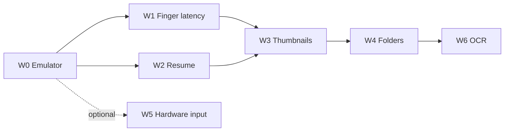

# Handoff: post-v1 roadmap for fastnote

**Status: IN PROGRESS (2026-07). W2 done; W1 half done; W0.5's doc half
done. Everything requiring the device is untouched — see the per-workstream
status lines.**
**Audience: an agent picking this up cold, with no memory of the session
that produced it.**

fastnote reached daily-use quality: drawing, color, eraser, palm rejection,
undo/redo, notebooks, SVG persistence all work on device. This document
plans what comes after, across six workstreams.

**Read first:** `plugins/fastnote.koplugin/AGENTS.md` (index),
`.github/instructions/lua.instructions.md` (dialect rules — the `_` vs `__`
gettext trap has caused real crashes here),
`.github/skills/test-driven-development/SKILL.md` (when a spec comes first
in this repo and when it can't).

**Every "current state" claim below was verified against the code at the
time of writing.** If something contradicts what you find, trust the code
and correct this document.

**Resuming mid-stream?** `.agents/plans/tidying-session-handoff.md` records
what the last session changed, the decisions it settled, the immediate next
actions, and the traps it hit. Read it before this file if you're picking up
rather than starting fresh.

---

## Decisions already made by the user

Answered during the planning session. **These are settled — implement them,
don't re-litigate them.** Where a decision went against the analysis, the
reasoning that lost is preserved in the relevant workstream so you know
which risks you're carrying, not so you can reopen the question.

| # | Decision | Chosen |
|---|---|---|
| D1 | Emulator display path over SSH | **VNC on a virtual display** (Xvfb/TigerVNC server-side) |
| D2 | Folder storage model | **Real filesystem subdirectories** — `notebooks/<folder>/<uuid>/` |
| D3 | OCR milestone 1 target | **Cheap proof-of-concept** — rasterize → the Tesseract already in koreader-base |
| D4 | Launch behavior with 2+ notebooks | **Resume last notebook + page**; browser stays reachable from the canvas menu |

---

## Suggested order, and why



- **W0 first** because everything after it is faster with a working
  emulator, and because W1 is reproducible in the emulator (see below).
- **W1 before the UI work** — it's the user's stated blocker on daily use,
  and it's already analysed in `.agents/notes/finger-draw-input-latency.md`.
- **W3 before W4, and they ship as one screen.** W4 rebuilds the loading
  menu around recents + a collapsible tree + per-notebook previews, and
  those previews *are* W3's output. Build the thumbnail generator and cache
  first (W3, invisible except for better-looking rows), then rebuild the
  screen once (W4). Reversing the order means building the loading menu
  twice.
- **W5 is a side quest**, safe to interleave anywhere; it must stay behind a
  flag and must not become a dependency of anything else.
- **W6 last** — largest, least certain, and its cheap first milestone
  depends on a ruled writing mode that doesn't exist yet.

---

## W0 — Emulator + dev loop

**Goal:** `./kodev run` working on the user's Ubuntu box, reachable from a
VS Code Remote-SSH session, at Libra Colour dimensions.

### Current state

`kodev` exists and is functional. `base/` (the `koreader-base` submodule) is
**not initialised** in this checkout — `ls base/` is empty. That submodule
carries the whole native toolchain, so nothing builds until it's fetched.

`kodev run -s=<preset>` has no Libra Colour preset. The presets stop at
`kobo-forma` (1440×1920 @300). Use explicit flags instead:

```bash
./kodev run -W=1264 -H=1680 -D=300
```

Those are the Libra Colour's real panel dimensions and DPI (`KoboMonza`,
`display_dpi = 300` in `frontend/device/kobo/device.lua`).

### Why the DPI flag matters more than it looks

`GestureDetector.PAN_THRESHOLD` is `screen:scaleByDPI(35)`
(`frontend/device/gesturedetector.lua`, `GestureDetector:init`). At
`-D=300` the emulator reproduces the same threshold the device uses — which
means **W1's finger-draw latency bug is reproducible in the emulator with a
mouse drag.** Run at the wrong DPI and the bug changes size or vanishes.

This is the single most valuable thing about getting W0 done first.

### Setup outline

Full step-by-step lives in the chat handoff that produced this doc; the
essentials:

1. `git submodule update --init --recursive` (or `./kodev fetchthirdparty`).
2. Ubuntu prerequisites — see `doc/Building.md` → "Debian/Ubuntu". Note
   KOReader now requires **SDL3 ≥ 3.2.12**; Ubuntu 24.04 LTS does not ship
   `libsdl3-0`, so either install the X11/Wayland `-dev` packages listed
   there and let the build compile SDL3 itself, or move to a release that
   packages it.
3. `./kodev build`, then `./kodev run -W=1264 -H=1680 -D=300`.
4. Display (D1 = VNC on a virtual display): run a VNC server on the Ubuntu
   box, point `DISPLAY` at it, launch `kodev run` inside that session, and
   connect with a VNC client from the workstation. The advantage over
   `ssh -X` that made this the choice: rendering happens server-side, so
   what you see reflects the emulator's real speed, and the session
   survives an SSH drop instead of taking the emulator down with it.
   VS Code Remote-SSH is then only doing what it's good at — editing and
   terminals — with the emulator window arriving over a separate channel.

### Pitfalls

- **The emulator cannot test what this plugin most needs testing.** No
  `/dev/input/eventX`, no `EVIOCGABS`, no E-ink waveform modes. It exercises
  the gesture path only (`use_raw_input = Device:isKobo()` → false). Every
  raw-evdev change and every refresh/waveform change still needs the device.
  See `.agents/notes/input-path-architecture.md`.
- Don't judge refresh behavior from the emulator — it has no A2, no GLRC16,
  no flash-promotion counter.
- If SDL3 gets built from source, that's a long first build. Budget for it.

### Possible follow-up

If the setup proves fiddly, it earns a
`.github/skills/emulator-dev-loop/SKILL.md` — it's a procedure, which per
`.github/instructions/doc-architecture.instructions.md` belongs in a skill,
not an instructions file.

---

## W0.5 — Re-validate the colour findings

**Status: the doc half is DONE (`1c50f79`) — all four docs below now carry
correction banners, so nothing in the colour docs asserts an artifact-era
claim unflagged. The re-testing half is untouched and needs the device.**

**Already checked, so you don't repeat it:** `_runColorSelfTest`'s bar loop
was switched to `paintRectRGB32` in the same commit as `drawLine`, so the
self-test's on-screen interpretation legend ("bars gray → a KOReader-level
gate is broken") is **valid today**. It was a guaranteed false positive at
the time Phase D was run, which is why the banner flags it there — but the
live code is correct and needs no change.

**Small, do it early, and do it before trusting anything in the colour
docs.** Not a feature — a correction pass.

Until commit `9e7d8b1` (2026-07), `canvas_utils.drawLine` painted through
`BlitBuffer:paintRect`, which downconverts to luminance even on an RGB32
buffer. **Every colour experiment before that fix was run on greyscale
pixels**, so several workarounds were built against a symptom that no
longer exists. Background: the banner at the top of
`.agents/notes/waveform-refresh-research.md`.

**What to re-test, now that real RGB reaches the buffer:**

1. **Is `live_ink_style = "solid"` still needed at all?** It exists to work
   around "A2 thresholds colour ink into a faint, sparse dither" — but what
   was being thresholded was luminance-converted pixels. If colour ink now
   looks acceptable live, the whole draw-black-then-bloom design is
   unnecessary complexity: a config key, a decision helper
   (`canvas_utils.live_ink_mode`), a spec block, and a standing source of
   confusion all go away. **Highest-value question here.**
2. **Does `live_color_refresh` still look "muted"?** Same artifact.
   If it doesn't, its config default is worth revisiting too.
3. **Does the tighten pass still earn its delay?** The *timing* findings
   are sound — mid-stroke lockout was real and independently caused — so
   expect the delay to survive. What may change is how much work the pass
   still has to do.

**Code that exists only to serve `live_ink_style = "solid"`** — audit it as
one unit, since it all lives or dies together:

- `lib/config.lua` — the `live_ink_style` key and its default.
- `lib/canvas_utils.lua` — `live_ink_mode()`, including its
  `tighten_enabled` parameter (added purely so disabling the tighten pass
  couldn't strand solid ink).
- `spec/canvas_utils_spec.lua` — the `live_ink_mode` describe block.
- `drawingcanvas.lua` — the `_display_diverged` flag and the
  `_rebuildDisplayFromStrokes()` call inside the tighten closure, which
  exist to repaint true colour over the solid ink before refreshing.
- `fastnote.conf.example` — the symptom prose for both `live_ink_style`
  and `live_color_refresh` ("faint / dotted while actively drawing",
  "instead of grayscale") describes the artifact.

**One fix to re-examine rather than trust:** "Fix E" in
`.agents/plans/color-drawing-fix-and-menu-access.md` set
`self.dithered = has_color_hw` and is marked DONE as the fix for "colour not
appearing on the tighten refresh." Colour could not have appeared either
way at that point, so **the fix was never validated against the symptom it
claims to fix.** Keep the line — `widget.dithered` is genuinely required for
dither promotion, per source — but don't cite Fix E as evidence for
anything.

**Docs still carrying uncorrected artifact-era claims** (the research note,
the grayscale handoff and the WFM runbook are already corrected — don't
double-correct those):

- `.agents/plans/color-pipeline-diagnosis-and-fix.md` — root cause 3, Task
  C2, Phase D. This is the sole written justification for solid ink.
- `.agents/plans/color-drawing-fix-and-menu-access.md` — Fix E, above.
- `.agents/plans/live-color-refresh-and-eraser-hardening.md` — the A2
  rationale and the "flip the default if it passes the matrix" checklist
  step, whose colour criteria were unrunnable at the time.
- `plugins/fastnote.koplugin/.agents/ADRs/adr-006-stage12-color-develop.md`
  — add to **Consequences** only; ADR Decision text is a historical record.

**What NOT to re-test** — real, and never the cause of the colour gap: the
device waveform map, the `"partial"` → full-flash promotion after
`FULL_REFRESH_COUNT`, the gate chain, A2's 1-bit behaviour, the DU/32bpp
driver bug.

Use the on-device matrix in
`.github/skills/waveform-experimentation/SKILL.md`. Correct the affected
sections of the research note in place as you go — don't delete them,
they're the record of what was tried, and the retraction trail is why the
next person won't repeat it.

---

## W0.6 — `avoid_flashing_ui` silently downgrades the tighten refresh

**Open, source-confirmed, unresolved.** Not artifact-related — this one is
read straight from KOReader's source and has never been acted on.

`frontend/ui/uimanager.lua` (~1137, 1144–1147): when the user has
`avoid_flashing_ui` set, a **regioned** `"partial"` refresh is silently
downgraded to `"ui"`. The tighten pass is exactly that — a regioned
`"partial"`+dither over the accumulated stroke bbox — and `"ui"` does not
carry the dither promotion, so on any device with that setting on, **the
tighten pass cannot produce colour at all.**

Nobody has confirmed whether the setting is on for this user, which is the
first thing to check. If it is, it's a second independent reason colour
appeared broken, and it is still live today.

Cheap to investigate, potentially embarrassing to leave: log the setting at
init alongside the existing gate snapshot, and if it's on, either force the
tighten refresh through a path that survives the downgrade or surface a
warning. Full detail: `.agents/notes/waveform-refresh-research.md` L455–469.

---

## W1 — Finger-draw first-contact latency

**Status: candidate 1 shipped (`221dc22`), unverified on device. Candidate 2
— the fix that actually removes the wait — is open and needs hardware.**

Candidate 1 back-fills the stroke to `ges.start_pos` via
`canvas_utils.stroke_seed_point`, which suppresses the back-fill when the
contact began outside the drawable area. That recovers the *discarded
prefix* only: ink still appears just as late, now in the right place. Do not
read the shipped fix as closing this workstream.

Already analysed. **Do not re-derive it** — read
`.agents/notes/finger-draw-input-latency.md`, which has the root cause, the
"which input path is actually drawing" check to run first, and four ranked
candidate fixes.

Only additions since that note was written:

- W0 gives you emulator reproduction at `-D=300` (above).
- Fix candidate 1 (seed the stroke from `ges.start_pos` instead of the first
  pan position) is verifiable in the emulator. Candidate 2 (make raw touch
  the finger path) is not — it needs the device.

---

## W2 — Resume last notebook and page

**Status: DONE (`d5393ca`), verified by spec, not yet exercised in the
emulator.** Kept here because W3 and W4 build directly on it — the
per-notebook `last_page` field below is what W4's recents row reads.

Two things landed differently from the plan below, both deliberate:

- **`Notebook:resolvePage` does not require the page's SVG file to exist.**
  The plan said it should. `addPage` writes the metadata entry but not the
  file, so a literal existence check bounces every newly created notebook
  back to the loading menu — and the browser's open path runs the same
  check, so it loops. The shipped check requires the notebook *directory*
  to be readable and the index to resolve to a real page entry, which still
  catches the moved/renamed/deleted cases the fallback rule exists for. A
  missing SVG inside an intact notebook is a blank page, not a dead path.
- **There were three copies of the restore logic, not two** — `_showBrowser`
  had one the plan didn't account for. All three now call
  `Library:resolveResume`.

**One consequence worth knowing:** a notebook can reach zero pages via
`deletePage`, and `resolvePage` returns nil for it. Such a notebook is
un-openable — tapping it in the browser quietly re-renders the browser. That
is correct under the fail-quietly rule, but it means an emptied notebook can
only be deleted from the UI, never repaired. If that turns out to matter,
the fix belongs in W4's loading-menu rebuild.

**Goal:** reopening fastnote lands on the page you left.

### Current state — mostly built already

This is much closer to done than it appears:

- `model/library.lua` `readState()` / `writeState()` persist
  `state.last_notebook_uuid` and `state.last_page_index` to
  `<datadir>/fastnote/state.lua`.
- `main.lua` writes both in `on_save_callback`, `on_page_forward`,
  `on_page_back`, and `on_page_jump`.
- `main.lua:onOpenFnoteCanvas` restores them **when there is exactly one
  notebook**, and `_showBrowser` restores the page when the notebook you
  pick happens to be the last-used one.

**The actual gap is one branch:** with 2+ notebooks, `onOpenFnoteCanvas`
unconditionally shows the browser and never resumes.

### The change (D4: resume)

In `onOpenFnoteCanvas`'s `count >= 2` branch, look up
`lib:byUUID(state.last_notebook_uuid)`. Found → open it at the clamped
`last_page_index`. Not found → fall through to the browser as today.

The single-notebook branch's restore logic is the same three lines; extract
a helper rather than writing a third copy (the repo's rule: a second
copy-paste means it needs a name — see `lua.instructions.md`).

### The fallback rule (user-specified, applies everywhere)

**Any time a notebook or page path fails to resolve — moved, renamed,
deleted, or just wrong — fall back to showing the loading menu. Never error,
never open a blank canvas at a dead path.**

This is a cross-cutting rule, not a W2 detail. It matters more under D2,
where folder renames move real directories, so W4 inherits it too. Concrete
obligations:

- Validate before showing the canvas: the notebook resolves by uuid **and**
  `nb:pagePath(idx)` names a file that exists. Either check failing →
  loading menu.
- Same check on the resume path, the browser's open path, and any future
  "recent notebooks" shortcut — all three can hold a stale reference.
- Fail quietly. A user whose folder reorganisation dropped them at the
  loading menu understands what happened; a Lua traceback tells them
  nothing.

> **Terminology:** the user calls this screen the **loading menu**. In the
> code it is `ui/browser.lua`, shown via `main.lua:_showBrowser`. Same
> screen. W4 turns it into recents + tree + previews, at which point
> "browser" undersells it — expect the name to drift.

### Per-notebook last page (needed by W4's recents row)

`last_page_index` in `state.lua` is **global** — it means "the page of
`last_notebook_uuid`", and it is meaningless for any other notebook. W4's
recent-notebooks row needs the last page for **each** of three notebooks,
which this cannot express.

Store it per notebook instead: a `last_page` field in that notebook's own
`notebook.lua` metadata, written by the same callbacks that write
`state.last_page_index` today. Three reasons this beats widening
`state.lua`:

- It travels with the notebook directory, so a D2 folder move can't
  orphan it.
- It scales to any number of recents without schema churn.
- It sidesteps `writeState`'s scalar-only limitation entirely.

`state.lua` then holds only the recents list (see W4) and app-wide display
state. Keep `last_page_index` writing during the transition so a downgrade
doesn't lose the user's place, and drop it once the per-notebook field has
shipped.

### Pitfalls

- **`writeState` only persists strings and numbers.** Look at the
  implementation: it iterates `pairs(t)` and writes only `string` and
  `number` values. Booleans are silently dropped — that's why `dark_mode` is
  stored as `1`/`0`. **Tables are dropped too**, which is why the recents
  list can't just be assigned as an array (see W4).
- **The stored page index can outlive its page.** Pages can be deleted;
  `last_page_index` is not updated when they are. The existing
  `math.max(1, math.min(idx, nb:pageCount()))` clamp is what makes this
  safe — preserve it in the new path, and in the per-notebook field above.
- **The stored notebook can be gone entirely** (deleted from the browser).
  `byUUID` returns nil; handle it rather than indexing nil.
- **Don't strand the loading menu.** If launch always resumes, the only
  route back is the canvas hamburger's existing `on_show_browser`. Verify
  that route works before shipping, or the user has no way to switch
  notebooks.

### Tests

`spec/library_spec.lua` already covers the state round-trip. Add: missing
uuid, uuid not present in library, page index beyond `pageCount`. The
`main.lua` routing itself is not unit-testable (KOReader runtime) — verify
in the emulator.

**Size: small.** A good first task to confirm the W0 loop works.

---

## W3 — Notebook thumbnails

**Goal:** a cached first-page preview image per notebook, for the loading
menu W4 builds (recents tiles + tree rows).

### Current state

`model/notebook.lua:getThumbnailPath()` returns `<nb.dir>/thumb.png` and is
spec'd (`spec/notebook_spec.lua`). **Nothing ever writes that file.** The
hook is there; the generator is not.

### Prior art to read before designing anything

`plugins/coverbrowser.koplugin/` solves exactly this problem for books:
`mosaicmenu.lua` (grid of covers), `listmenu.lua` (list rows with
thumbnails), `bookinfomanager.lua` (thumbnail cache + invalidation). Read
these before inventing a layout. Reusing their menu subclasses may be
possible; at minimum steal the caching approach.

### Design decisions

1. **When to generate.** On page save (costs time during drawing), on canvas
   close, or lazily when the browser opens (first paint is slow). Suggested:
   on save of **page 1 only**, debounced — the browser only ever shows one
   thumbnail per notebook, so generating for other pages is wasted work.
2. **How to rasterize.** The canvas already renders strokes into a
   `BlitBuffer`; the thumbnail is a downscaled copy. Find the PNG writer
   KOReader's screenshot feature uses (in `koreader-base`, exposed through
   the frontend) rather than adding a dependency — confirm the exact call
   before planning around it.
3. **Invalidation.** A thumbnail whose page has changed is worse than none.
   Store the source page's mtime (or stroke count) alongside it and
   regenerate on mismatch.
4. **~~List vs grid~~ — settled by W4: both.** The loading menu the user
   specified uses tiles for the recents row and thumbnailed rows for the
   tree. So the generator must produce one image usable at two sizes; render
   at the larger (tile) size and let the row rendering scale down, rather
   than caching two files per notebook.

**Which page gets thumbnailed: page 1.** The user asked for "the first page
of said notebook" — so this is not the *current* page and not the last-edited
page. That simplifies invalidation considerably: only edits to page 1 dirty
the thumbnail, and pages 2..n can be ignored entirely.

### Pitfalls

- **E-ink refresh cost.** A grid of images is a large-area update. Follow
  `.github/skills/waveform-experimentation/references/eink-refresh-rules.md` — in particular, never
  per-item `"partial"` refreshes, which get promoted to a full flash after
  six.
- Dark mode: thumbnails are rendered from stroke data, and stroke color is
  canonical light-mode hex (`.agents/notes/stroke-color-invariant.md`). A
  thumbnail rendered in dark mode and cached will look wrong in light mode.
  Render thumbnails in one fixed mode, or key the cache by mode.
- Blank first pages produce blank thumbnails. Decide whether that's fine
  (it's honest) or whether to fall back to the first non-empty page.

---

## W4 — Folders / notebook organization

**Goal:** folders (later, sub-folders) containing notebooks; move notebooks
between them; rename/create/delete folders; user-chosen sort order.

This is the largest workstream, and **D2 chose the harder of the two storage
models**. Read "The shape of the chosen model" below before touching code —
most of the risk in this workstream is concentrated in that choice, and it
is all manageable if you handle it deliberately.

### Current state

- Storage is flat: `<datadir>/fastnote/notebooks/<uuid>/`, one dir per
  notebook, per `ADRs/ADR-006-uuid-directory-layout-for-notebooks.md`.
- `Library:_scan()` shells out to `io.popen("ls -1 ...")` over that one
  directory — a flat, single-level scan.
- Ordering exists in two places: `Library:_sortOrder()` (by `last_edited`)
  and `ui/browser.lua`'s `_sorted_nbs` (session-only `_sort_by`, name or
  recency). **They duplicate each other.** Resolve that while you're in
  here rather than adding a third ordering.
- `ui/browser.lua` is a flat `Menu` with a "+ New notebook" row, a sort
  toggle row, then one row per notebook. Long-press opens a
  rename/delete `ButtonDialogTitle`.

### The shape of the chosen model

D2: folders are **real directories**. Layout becomes:

```
<datadir>/fastnote/
  state.lua
  notebooks/
    nb_1748736123_001_004521/     ← unfiled (root level) — today's layout, still valid
    Work/
      .folder.lua                 ← folder metadata: display name, manual sort order
      nb_1748736140_002_881204/
      Projects/                   ← sub-folder, same rules, recursive
        .folder.lua
        nb_.../
```

What this buys, and why the user picked it: the library is legible over USB
or SSH. You can back it up with `rsync`, inspect it with `ls`, and rescue a
notebook with `cp` — no manifest to interpret. For a notes app holding
handwriting that exists nowhere else, that transparency is worth real
engineering cost.

Four consequences follow directly, and each has a mitigation you should
build in from the start rather than retrofit:

**1. Identity must stay the UUID; the path is derived.**
This is the load-bearing rule of the whole workstream. `Library:_scan()`
becomes recursive and builds a `uuid → absolute path` map. Every lookup goes
through that map. **Never persist a path anywhere** — not in `state.lua`,
not in folder metadata. `state.last_notebook_uuid` then survives any move or
rename for free, which is exactly what W2 depends on.

**2. A directory rename invalidates paths held by an open canvas.**
`DrawingCanvas` captures `load_path` / `_page_path` at open time. Rename an
ancestor folder while a canvas is open and its saves go to a path that no
longer exists. Two defences, cheap, use both:
   - Only offer folder operations from the browser, and confirm the canvas
     is actually closed when the browser is showing (check what
     `on_show_browser` does with the canvas — if it leaves it on the
     UIManager stack, that's the hazard).
   - On save, re-resolve `uuid → path` rather than trusting the captured
     one. This makes the whole class of bug impossible instead of unlikely.

**3. Telling a folder from a notebook during the scan.**
A notebook directory contains `notebook.lua`; a folder directory does not.
That is the discriminator — it needs no new marker file and it makes
today's flat layout a valid special case (root-level notebook dirs are
simply unfiled). **No migration step is needed**, which is a genuine
advantage of this model. Guard against pathological nesting anyway: cap
recursion depth and ignore a directory containing both `notebook.lua` and
child notebook dirs rather than trying to interpret it.

**4. User-typed names now reach the filesystem and the shell.**
See the blocking prerequisite below. Under the metadata model this would
have been optional hardening; here it is a correctness requirement.

`.folder.lua` still exists under this model, but only for what the
filesystem can't express: a display name that differs from the directory
name (so renaming the display name doesn't have to `mv` anything), and the
manual sort order the user asked for. A folder with neither is just a
directory with no metadata file — handle its absence as "defaults", never
as an error.

### Documentation obligations for this choice

- **ADR-006 needs a Consequences addendum**, not an edit to its Decision
  text — it currently mandates a flat UUID layout, and reality is diverging.
  Append; don't rewrite. See
  `.github/instructions/agents.instructions.md` → "ADRs are historical
  records".
- **A new ADR (next free number: ADR-008)** records the folder decision:
  filesystem directories chosen over the metadata model, transparency over
  USB as the deciding factor, with the four consequences above as the
  accepted tradeoffs.

### Blocking prerequisite: shell quoting

**Status: bullet 1 (quoting) is DONE. Bullets 2 and 3 are NOT — this
section is still blocking, just for a different reason than it was.**

Every interpolated path now goes through `lib/shell_quote.quote` (POSIX
single-quote wrapping, `'` → `'\''`), covering `model/library.lua`'s
`mkdir -p`, `rm -rf` and `ls -1` scan, `model/notebook.lua`'s `mkdir -p`,
and `drawingcanvas.lua`'s log-dir `mkdir -p`. Real-shell round-trip specs
prove a name like `` x ; rm -rf sentinel ; $(touch pwned) `id` `` is inert.

**Do not read that as "folders are now safe."** Quoting makes the *shell*
safe; it does nothing about names that are hostile to the *filesystem*, and
those are bullet 2's job:

- **`/` silently becomes a path separator** — `mkdir -p '<base>/a/b'`
  happily nests. Quoting cannot catch this; `/` is meaningful to the
  filesystem, not the shell.
- **`.` and `..`** escape or collide with the notebooks root.
- **A newline breaks `Library:_scan` regardless of quoting** — `ls -1` is
  line-oriented, so one such name reads back as two bogus entries. This is
  the one hazard quoting genuinely cannot fix, and the strongest argument
  for dropping the `ls` parse in favour of `lfs`/ffi iteration.
- Empty-after-trim, leading/trailing whitespace, and a length cap.

What did change: bullet 2's rule set is now smaller and purely a
filesystem-validity concern, and bullet 3's slug decision is now a
readability/stability choice rather than a security one.

**Worth doing before W4 adds call sites:** three of the five sites are
`mkdir -p`. Named helpers (`shell_quote.mkdir_p(path)` and friends) would
make new call sites safe by default rather than safe by remembering. Left
undone deliberately — it was outside the quoting task's scope.


`model/library.lua` and `model/notebook.lua` build shell commands by string
concatenation with no quoting:

```lua
os.execute("mkdir -p " .. base_dir .. "/notebooks")
os.execute("rm -rf " .. nb.dir)          -- Library:deleteNotebook
io.popen("ls -1 " .. self:_nb_dir() .. " 2>/dev/null | sort")
```

Today every one of those paths is machine-generated (`nb_<ts>_<seq>_<rand>`)
so nothing user-typed reaches a shell. **D2 changes that** — under
filesystem folders, a user-typed folder name lands directly in every one of
those command strings. A folder named with a space breaks the scan outright;
a folder name containing shell metacharacters turns `rm -rf` into something
much worse than a bug.

Do this **first**, before any folder feature is wired up:

- Quote every interpolated path (`'%s'` with embedded single quotes escaped,
  or move off `os.execute`/`io.popen` to a helper that does it once).
- **Sanitize folder names on input**, in the browser's create/rename dialog:
  reject or strip `/`, control characters, leading `.` and `..`; cap length;
  reject empty-after-trim. Sanitize at the boundary, once — not at each use
  site.
- Consider decoupling entirely: directory name = a sanitized slug,
  display name = the user's string in `.folder.lua`. Then arbitrary user
  text never reaches the filesystem at all, and you keep the readable
  layout the user wanted. This is the recommended shape.

This is not optional polish. `rm -rf` with an unquoted user-supplied string
is how a notes library gets destroyed by a folder named `My Notes; oops`.

### The loading menu — the screen this workstream really builds

The user specified the layout directly. Top to bottom:

```
┌──────────────────────────────────────────┐
│ Recent                                   │
│  [thumb] [thumb] [thumb]                 │  ← last 3 opened, tap = jump
│   Ideas   Work    Journal                │    straight to that notebook's
├──────────────────────────────────────────┤    last-opened page
│ ▾ Work                                   │
│     [thumb] Meeting notes    12p · Jul 3 │  ← collapsible tree,
│   ▸ Projects                             │    previews per notebook
│ ▸ Personal                               │
│   [thumb] Scratch            2p  · Jul 1 │  ← unfiled, root level
└──────────────────────────────────────────┘
```

Three pieces, each with its own gotchas.

**1. Recents row (last 3 opened).**
Tapping a recent jumps to that notebook's last-opened page — which is
exactly why W2 moves last-page tracking into per-notebook metadata. Read
that section first; the global `last_page_index` cannot serve this.

Storing the list is the other half. `Library:writeState` **drops table
values on the floor** (it writes only strings and numbers), so
`state.recent = {uuid1, uuid2, uuid3}` silently persists as nothing. Two
honest options:

- Flat scalar keys — `recent_1`, `recent_2`, `recent_3`. Zero changes to
  `writeState`, ugly, and a fixed cap of 3 baked into the schema.
- Extend `writeState` to serialise a flat array of strings. Slightly more
  code, spec-able in `library_spec.lua`, and the cap becomes a UI choice
  instead of a storage one. **Preferred** — the cap will change the moment
  the user sees four notebooks they use daily.

Either way, the recents list is a *cache of uuids*, never paths, and every
entry gets the W2 fallback treatment: a uuid that no longer resolves is
skipped silently and the row shows fewer than three. Never show a dead tile.

**2. Collapsible directory tree.**
The user asked for expandable/collapsible nodes twice, so build that — the
breadcrumb alternative considered earlier is off the table.

**KOReader has no tree widget.** `Menu` is a flat, paginated list. The way
to get a tree out of it is to keep the tree in your own model and flatten it
to visible rows on each render:

- Keep `expanded = {[folder_path] = true}` as view state, held by the
  loading menu, not persisted in `.folder.lua` (expansion is a UI mood, not
  a property of the folder). Persisting it across sessions is a nice
  follow-up, not part of the first cut.
- Render: walk the tree depth-first, skipping children of collapsed nodes,
  emitting one row each with an indent prefix and a `▸`/`▾` marker.
- A folder row's tap toggles expansion and rebuilds `item_table`. A notebook
  row's tap opens it.

**The pagination interaction is the part that will bite.** Expanding a node
inserts rows, which reflows every page boundary below it. Expand something
near the bottom of page 1 and the rows you just revealed may land on page 2,
so the screen appears not to have changed. Mitigate by recomputing which
page contains the toggled node after the rebuild and jumping there — do it
in the first cut, not as polish, because the alternative reads as a broken
button.

**3. Preview thumbnails.**
Both the recents tiles and the tree's notebook rows show the notebook's
**first page** rendered small. That is W3's output — see that workstream for
generation, caching, and invalidation. This workstream just consumes
`nb:getThumbnailPath()` and must degrade gracefully when the file isn't
there yet (placeholder, never a blank row, never a stall waiting on
generation).

### The move-to-folder flow

Per-notebook `...` options entry → "Move to folder" → the same tree widget
from above in a picking mode, with create/rename/delete available inline.

Build the tree renderer **once** and parameterise it (browse mode → tap
opens the notebook; pick mode → tap selects a destination). Two copies of
tree-flattening logic that drift apart is the predictable failure here, and
the repo's own rule says the second copy-paste means it needs a name.

### Deletion confirmation

The user asked for: confirm always; a **second** confirmation when the
folder is non-empty, and that second notice must **list the notebooks that
would be deleted**.

Current `_context_menu` delete is a single confirm. Note the list can be
longer than the screen — cap it ("… and 7 more") rather than overflowing a
dialog. Consider offering "move contents up one level" as an alternative to
destroying them; it's the option most users actually want.

### Pitfalls

- **A notebook that appears in no folder listing is indistinguishable from a
  lost notebook.** Any notebook dir the recursive scan finds must surface
  somewhere in the UI, even if its location is unexpected — fall back to
  showing it at root rather than hiding it. Losing a notebook from the UI
  reads as data loss even when the file is perfectly intact on disk.
- **Manual sort order lists UUIDs in `.folder.lua`.** A UUID present in the
  order list but missing from disk must be skipped silently; a notebook on
  disk but absent from the order list must still appear (append it). Never
  let the order file act as a filter — that's the "lost notebook" bug in
  another costume. Sparse ordering (10, 20, 30 …) avoids renumbering every
  entry on each move.
- **A move is `mv`, and `mv` can fail** — target exists, permissions, no
  space. Check the result; `os.execute` returns a status that today's code
  ignores everywhere. A silently failed move that the UI reports as success
  is worse than an error dialog.
- **Two notebooks can't share a directory name, but two folders can want the
  same display name.** If you take the slug-plus-display-name approach
  above, handle slug collision (suffix `-2`) rather than failing the create.
- `Library:_scan()` currently loads every notebook at startup, and recursion
  makes that walk larger. Measure before optimising — a handful of notebooks
  is nothing, and lazy scanning complicates the uuid→path map that
  everything else now depends on.

### Tests

`model/` and the folder manifest are pure Lua — fully spec-able, and this
workstream is the strongest TDD candidate of the six. `ui/browser.lua` needs
the KOReader runtime; verify it in the emulator.

---

## W5 — Hardware-level input exploration

**Goal (as stated by the user):** get closer to the metal than KOReader's
input layer allows — hardware palm rejection first, maybe hardware finger
draw and pen reading, explicitly "for the heck of it."

**Plan:** the kernel-module direction (an `input_handler` filter module, a
QEMU and KUnit test rig, then a home-grown digitizer driver) is planned in
`.agents/planning/kernel-palm-rejection/`. Planning only; no kernel code exists.

Treat this as a **research spike behind a flag**. It must not become a
dependency of W2/W3/W4.

### Reality check on the approach — read this before buying an I2C book

The user mentioned I2C nodes and hwmon. Setting expectations honestly:

- **hwmon is the wrong subsystem.** It exposes temperature/voltage/fan
  sensors. The digitizer is not there.
- **Raw I2C (`/dev/i2c-N`, `i2cget`) fights the kernel driver.** The Elan
  chip is already claimed by an in-kernel driver that is actively
  transacting on that bus. A second userspace master on the same bus
  produces corrupt reads and can wedge the controller. This is not a "be
  careful" — it's the normal outcome.
- **The genuinely low-level surface available to userspace is evdev**: the
  ioctls (`EVIOCGABS`, `EVIOCGBIT`, `EVIOCGRAB`), the raw event stream, and
  the driver's own sysfs attributes under `/sys/bus/i2c/devices/`. That is
  where the embedded-systems interest can actually be scratched without
  fighting the kernel, and this plugin already lives there
  (`input/pendev.lua`, `input/touchdev.lua` use FFI + raw ioctls).

### The highest-value thing to check first

**The digitizer may already be reporting palm contacts, and fastnote is
throwing that away.**

- `lib/input_codes.lua` defines `ABS_MT_TOOL_TYPE = 0x37` and the
  `MT_TOOL_*` value table. `lib/eventlog.lua`'s format example shows a
  captured-looking `ABS_MT_TOOL_TYPE 2` line — and in Linux input,
  `MT_TOOL_PALM == 2`.
- **`input/touchdev.lua` does not parse `ABS_MT_TOOL_TYPE` at all.** It
  handles `ABS_MT_SLOT`, `ABS_MT_TRACKING_ID`, `ABS_MT_POSITION_X/Y` and
  `ABS_MT_TOUCH_MAJOR` only.

If the Elan chip really emits `MT_TOOL_PALM`, that is *hardware* palm
rejection — the controller's own classification — and wiring it in is maybe
twenty lines. **Verify with `evtest` on device before building anything.**
Rest a palm on the panel, watch for `ABS_MT_TOOL_TYPE` transitions.

### The second-cheapest thing, also already half-built

`lib/palmreject.lua` has an area gate: contacts with
`touch_major > area_threshold` are rejected regardless of pen state. It is
**disabled by default** (`area_threshold = 0` means off), and
`drawingcanvas.lua` constructs it with `PalmReject.new()` — no options, no
config key. So the area gate has never run in production.

`touchdev.lua` already reads `ABS_MT_TOUCH_MAJOR`, so the data is flowing.
Wiring `area_threshold` to a config key and tuning it on device is a
contained, testable improvement (`spec/palmreject_spec.lua` already covers
the gate's logic).

### Suggested spike sequence

1. On device, enumerate: `cat /proc/bus/input/devices`, then `evtest` on the
   digitizer node. Record which `ABS_MT_*` axes actually carry data, and
   their `EVIOCGABS` ranges.
2. Check for `ABS_MT_TOOL_TYPE` / `MT_TOOL_PALM`. If present → wire it into
   `touchdev.lua` and `palmreject.lua` as a first-class rejection rule.
3. If absent → wire and tune `area_threshold` instead.
4. Only then consider anything more exotic. Read the driver's sysfs
   attributes; don't open the I2C bus.

Capture findings in `.agents/notes/` — the enumeration output is exactly the
kind of device fact that gets re-derived expensively otherwise.

### Pitfalls

- **Two readers already share `/dev/input/event1`** (`pendev` and
  `touchdev`, per the combo-chip quirk in the plugin's AGENTS.md). Don't add
  a third fd. Extend the existing reader.
- **Never `EVIOCGRAB` the digitizer.** Grabbing it takes input away from
  KOReader itself; if the plugin then crashes, the device is unusable
  without a reboot.
- Anything here is untestable in the emulator and untestable in `busted`
  (FFI). It rides on device validation only — which is the trade for
  working at this level.

---

## W6 — OCR / handwriting recognition

**Read `.agents/planning/fastnote-ocr-landscape-research.md` first and do
not redo it.** It already covers what the device can do, what Kobo ships
(MyScript `iink`, commercially licensed — a legal dead end for reuse),
candidate open engines, and a recommended milestone 1.

### The constraint that shapes everything

`lib/stroke.lua` stores `pts = {x1,y1,w1, x2,y2,w2, ...}` — position and a
pre-baked width. **No per-point timestamps, no raw pressure.** Online
handwriting recognizers (the MyScript class, the ones that feel magic) want
a timestamped stroke stream. Without timestamps you are doing offline,
bitmap-based OCR on a rasterized page.

### The one decision worth making early — and what the format would be

Adding timestamps is cheap *now* and expensive later: the format is young
and there is one user. Reversing the decision later means every page written
in the meantime lacks the data and can never be recovered. So decide it
deliberately.

**Yes, pages are SVG — and they stay SVG.** Timestamps do not change that.
Here is exactly where they'd live.

#### What the format is today

`lib/stroke.lua` stores points as a flat array, **stride 3**:

```lua
pts = {x1, y1, w1,  x2, y2, w2,  ...}   -- w = pressure-derived line width
```

`lib/svg.lua` writes two representations of the same strokes into one file:

```xml
<svg …>
  <rect …/>
  <polyline points="x,y x,y …" stroke="#cc2222" stroke-width="3" …/>  ← visual
  <metadata>
    <fn:data xmlns:fn="urn:fastnote:1">
      {"version":1,"w":1264,"h":1680,"strokes":[{"color":"#cc2222","pts":[…]}]}
    </fn:data>
  </metadata>
</svg>
```

The `<polyline>` elements are what any SVG viewer renders; the JSON block in
`<metadata>` is the lossless per-point record fastnote reads back
(`svg.read` tries JSON first, falls back to parsing polylines). ADR-001
covers this design.

**The key consequence: timestamps go in the JSON metadata block only.** The
`<polyline>` elements are untouched, so the file remains a valid, viewable
SVG. That property is the whole point of ADR-001 and must not be traded away
for recognition features.

#### Option A — widen the stride to 4

```lua
pts = {x1, y1, w1, t1,  x2, y2, w2, t2, ...}
```

Simple to describe, unpleasant to implement: the literal `3` is hardcoded in
**six** loops — `Stroke:isEmpty` (`< 6`), `pointCount` (`/3`), `bbox`,
`hitTest`, `paintTo` (all `for i = 4, #pts, 3`), and `svg.write`'s averaging
loop. Miss one and geometry silently corrupts — strokes render with points
interpreted as widths. If you take this path, replace every literal with a
`POINT_STRIDE` constant in the same commit.

#### Option B — parallel timing array (recommended)

Leave `pts` alone at stride 3. Add timing beside it:

```lua
{
  color = "#cc2222",
  pts   = {x1,y1,w1, x2,y2,w2, ...},   -- unchanged, stride 3
  t0    = 1748736123456,               -- stroke start, ms
  ts    = {0, 8, 17, 25, ...}          -- ms deltas from t0, one per point
}
```

Why this wins:

- **Zero changes to the six geometry loops.** No silent-corruption class of
  bug at all.
- **Backward compatible:** old files have no `ts`; `Stroke.fromTable` sets
  it nil, and everything works — timing is simply absent.
- **Forward compatible:** an older build reading a new file ignores `ts` and
  renders correctly, because the geometry array is unchanged.
- **Deltas keep it small.** Storing `1748736123456` per point would roughly
  double the JSON; small integer deltas (`0, 8, 17`) cost ~3 characters
  each. Rough order of magnitude on a densely written page (~200 strokes ×
  ~40 points): the existing `pts` runs ~80 KB of JSON text, and deltas add
  ~30 KB. Measure on a real page before committing to it — that estimate is
  arithmetic, not observation.
- `t0` as an absolute millisecond value gives inter-stroke gaps, which is
  what word and line segmentation actually needs.

The cost is two arrays that must stay in lockstep. Enforce it in
`Stroke:addPoint` (append to both, always) and assert
`#ts == #pts/3` in `fromTable`, degrading to "no timing" on mismatch rather
than trusting a corrupt file.

#### Option C — per-stroke times only

Just `t0` and `t_end`, no per-point array. Gives stroke ordering (already
implicit in array order) and pen-up durations, which is enough for
segmenting words and lines — but no velocity, no intra-stroke dynamics.
Cheapest by far. A defensible stopping point if the OCR work stays at the
bitmap level, since bitmap recognition uses none of it.

#### Where the clock comes from — a constraint, not a detail

`lib/stroke.lua` is deliberately dependency-free: *"Pure Lua; no KOReader
runtime dependencies for all methods except `paintTo`."* That is what makes
it busted-testable, and it must not be broken for this.

So **`stroke.lua` must never read the clock itself.** The timestamp is
passed in by the caller — `Stroke:addPoint(x, y, w, t)` — and
`drawingcanvas.lua` supplies it from KOReader's `ui/time` (already required
there for `LIVE_REFRESH_INTERVAL_FTS`). `os.time()` is useless here: it has
one-second resolution and pen samples arrive every ~8 ms.

Tests then inject synthetic timestamps, which is the same injectable-clock
pattern `lib/palmreject.lua` already uses for `clock_fn`.

#### Versioning and the ADR

Bump the metadata block to `"version": 2` once timestamps ship. Today's
`svg.read` doesn't inspect `version` at all — it only checks that
`data.strokes` is a table — so the bump is safe for old readers and gives
future ones something to branch on.

This extends ADR-001 rather than replacing it. Per the repo's convention,
add to ADR-001's Consequences and write a new ADR for the timing format
decision itself; don't rewrite ADR-001's Decision text.

#### The honest caveat

Under D3, milestone 1 is bitmap OCR, which **uses none of this**. Timestamps
are insurance: cheap to add now, impossible to backfill later. If they slow
down anything else, defer them — but defer them knowing that every page
written meanwhile is permanently timing-less.

### Milestone 1 (D3: the cheap proof-of-concept)

Per the research doc, in order:

1. **A ruled / structured writing mode** for the canvas — constrained line
   height and margins. This is worth having on its own merits, and it is
   the same trick that makes Kobo's own Advanced Notebook tractable.
   Unconstrained freeform handwriting is a much harder recognition problem.
2. **Rasterize a page and run it through the Tesseract already in
   `koreader-base`** (KOReader uses it for scanned PDF/DjVu; see
   `frontend/ui/data/ocr.lua`). Zero new native dependencies. Expect
   mediocre accuracy — it's a print-OCR engine. The point is to answer "is
   this the right ballpark on this CPU" before anyone cross-compiles
   anything.
3. Only if (2) is clearly inadequate, move to a purpose-built handwriting
   model (Calamari, or a small trained CRNN/CTC) and accept the ARM
   cross-compile lift. **No cross-compile machinery exists in this repo
   today** beyond what `koreader-base` provides.

### On "training mode"

The user wants to write sample A–Z sheets and have the system learn their
hand. Be honest about the architecture: **training does not happen on the
Kobo.** A realistic shape is three parts —

1. **On device:** a guided capture mode that prompts for each letter and
   saves labelled samples. This part is genuinely fun and entirely within
   the plugin's existing capabilities.
2. **On desktop:** the actual training run (Tesseract fine-tuning, or a
   CRNN trained on the samples), producing a model artifact.
3. **Back on device:** drop the artifact in and select it.

Part 1 can be built long before parts 2 and 3 exist, and it's useful on its
own — a labelled corpus of the user's handwriting is the prerequisite for
every engine choice, so capturing it early costs nothing and keeps options
open.

### Pitfalls

- Don't let OCR drive a rewrite of the stroke model beyond timestamps. ADR-002
  (StrokeBuffer is the source of truth) still holds; OCR is a consumer.
- Recognition latency on this CPU is measured in seconds. Design it as an
  explicit "convert this page" action with a progress indicator, never as
  something that runs while writing.
- Accuracy will disappoint at first. The user has already said they don't
  mind slow or inaccurate — hold them to that framing and ship the ugly
  version rather than polishing toward a target this hardware won't hit.

---

## Cross-cutting obligations

**ADRs likely needed** (`.agents/ADRs/`, next free number is ADR-008):
folder storage model (W4), thumbnail generation and caching strategy (W3),
stroke timestamps if adopted (W6). One per settled decision, written when
it's settled — not in advance.

**Existing ADRs that need Consequences addenda** (append, never rewrite the
Decision text): **ADR-006** once folders land, since it mandates a flat UUID
layout; **ADR-001** if timestamps ship, since it defines the SVG + metadata
format they extend.

**Doc-as-code:** every code change carries its doc change in the same pass —
`fastnote.conf.example` for new config keys, the plugin AGENTS.md File Map
for new files, the relevant `.agents/notes/` topic for changed behavior. See
`.github/skills/documentation-as-code/SKILL.md`.

**Testing:** `lib/` and `model/` are pure Lua and get specs first.
`drawingcanvas.lua`, `ui/`, and `input/` cannot be unit-tested here —
emulator for widget/gesture behavior, device for raw input and refresh. See
`.github/skills/test-driven-development/SKILL.md`.

**Test gate:** `cd plugins/fastnote.koplugin && busted spec/` before any
commit.
